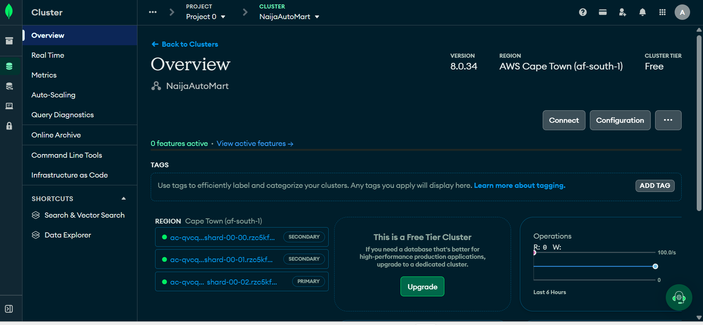

# Advanced Database Systems Portfolio: NaijaAutoMart

**Adebajo Ayobamidele** · Student ID **301931278**
MIT 8103 Advanced Database Systems · MIVA Open University · Master of Information Technology · 2026/2027 First Semester Continuous Assessment

**GitHub repository:** https://github.com/AyobamiAdebebajo95/advanced-database-portfolio

*MIT = Master of Information Technology. Every abbreviation is spelled out on first use and listed in [docs/abbreviations.md](docs/abbreviations.md).*

---

## 1. Selected case study: NaijaAutoMart online store

| Brief requirement | NaijaAutoMart |
|---|---|
| **Organisation / scenario** | NaijaAutoMart, a simulated Nigerian online store for **cars and auto parts** |
| **Nature of the business** | Car dealers and parts shops list cars and parts. Customers buy parts online for delivery, or book an inspection before buying a car |
| **Users of the database** | Customers, sellers (car dealers and parts shops), delivery agents, admins |
| **Major data stored** | Customers, sellers, car models and listings, parts and categories, which parts fit which car, stock, orders, payments, deliveries, inspections, reviews |
| **Key operations** | List cars and parts; find parts that fit a car; place an order and take payment; update stock; book an inspection; track deliveries; sales reports |

The same case study and data are used in all five portfolios.

---

## 2. The five portfolio activities

| Portfolio | Activity | Marks | Status |
|---|---|---|---|
| [Portfolio 1](portfolio-1-database-design/) | Database Design and Modelling | 7 | Done |
| [Portfolio 2](portfolio-2-query-optimisation/) | Query Processing and Optimisation | 7 | Done |
| [Portfolio 3](portfolio-3-transactions-concurrency/) | Transactions and Concurrency | 7 | Done |
| [Portfolio 4](portfolio-4-nosql/) | NoSQL (Not only SQL) and Advanced Data Models | 7 | Done |
| [Portfolio 5](portfolio-5-distributed-cloud/) | Distributed and Cloud Database Exercise | 6 | Done |
| Final Documentation | This page, [reflection](docs/final-reflection.md), [AI use declaration](docs/ai-use-declaration.md) | 6 | Done |

### Portfolio 1: Database Design and Modelling (PostgreSQL)
I designed **14 tables** in PostgreSQL with primary, foreign and unique keys, `CHECK`, `NOT NULL` and `DEFAULT` constraints, and deliberate `ON DELETE` rules. I drew a crow's foot **ER (Entity-Relationship) diagram** and normalised the data step by step from an unnormalised order form to **3NF** (Third Normal Form), which also passes **BCNF** (Boyce-Codd Normal Form).
**Key result:** all **12 constraint tests** were blocked as intended (duplicate email, negative stock, unknown customer and others), and the design answers "which parts fit a 2015 Corolla?" in one query. [Details and 24 screenshots →](portfolio-1-database-design/)


### Portfolio 2: Query Processing and Optimisation
I loaded **200,008 orders** and **500,012 order items**, then used `EXPLAIN (ANALYZE, BUFFERS)` to compare execution plans before and after optimising, using composite, partial, expression and foreign-key indexes and a **materialized view**.
**Key results (my PC, PostgreSQL 18):** customer order history went from a Seq Scan at **124.17 ms** to an Index Scan at **0.45 ms** (~270× faster). Login by email went from **18.33 ms** to **0.20 ms**. The monthly report was not helped by an index, but a materialized view brought it to **0.065 ms**. Cost: inserts became about **35% slower** with the five extra indexes. [Details and 26 screenshots →](portfolio-2-query-optimisation/)

### Portfolio 3: Transactions and Concurrency
I showed `COMMIT`, `ROLLBACK`, `SAVEPOINT`, and a `place_order()` function that makes the whole order one transaction. Using two pgAdmin tabs as two customers, I reproduced a **lost update** (the last headlamp sold twice), then fixed it with `SELECT … FOR UPDATE` and with an atomic conditional `UPDATE`. I also compared isolation levels and caused, then prevented, a **deadlock**.
**Key results:** with the fixes, only 1 headlamp was sold (the second buyer **waited 1 min 6 s** for the lock, then saw stock 0). There was no dirty read, a non-repeatable read at READ COMMITTED but not at REPEATABLE READ (error 40001), and a deadlock (40P01) that was avoided by locking parts in the same order. [Details and 52 screenshots →](portfolio-3-transactions-concurrency/)

### Portfolio 4: NoSQL and Advanced Data Models (MongoDB Atlas)
I rebuilt the store as **4 MongoDB collections** with `$jsonSchema` validation. Order items, payments and delivery are **embedded** in the order; customers are **referenced**. I wrote CRUD (Create, Read, Update, Delete) operations, aggregation pipelines (including a `$lookup` join), and compared plans before and after indexes.
**Key results:** 5,000 customers, 2,000 parts and 30,008 orders loaded. Order totals match PostgreSQL. An index changed a query from **COLLSCAN reading 30,008 orders** to **IXSCAN reading 0**. A **multikey index** cut the Corolla-parts query from 2,000 documents read to 396. All 5 invalid inserts were rejected. **Conclusion:** polyglot persistence, with PostgreSQL for money and stock, and MongoDB for the catalogue and reviews. [Details and 34 screenshots →](portfolio-4-nosql/)

### Portfolio 5: Distributed and Cloud Database Exercise (MongoDB Atlas)
My Atlas cluster is a **3-node replica set** in **AWS (Amazon Web Services) Cape Town**. I tested replication, write and read concerns, causal consistency, a multi-document **ACID** (Atomicity, Consistency, Isolation, Durability) transaction, a **sharding** design (simulated on real data, because the free tier cannot be sharded) and a **backup and restore**.
**Key results:**
- **Replication:** `rs.status()` showed 1 PRIMARY and 2 SECONDARY nodes; the same query was answered by different servers depending on read preference.
- **Consistency:** `w: 'majority'` cost nothing extra (135 ms against 152 ms for `w: 1`). A causal session guaranteed read-your-own-writes on a secondary (0 misses in 100).
- **Transaction:** 1 commit and 2 rollbacks; stock was never left wrong.
- **Sharding:** hashed `customerId` spread orders evenly (9,591 / 10,001 / 10,417), while a date key put **100%** of new orders on one shard.
- **Backup and restore:** all 2,000 parts deleted, then restored with every value matching.

[Details and 35 screenshots →](portfolio-5-distributed-cloud/)



---

## 3. Repository and evidence

```
advanced-database-portfolio/
├── portfolio-1-database-design/          scripts/ (01–04 .sql), ER diagram, normalisation.md, evidence/
├── portfolio-2-query-optimisation/       scripts/ (01–04 .sql), plans before/after, evidence/
├── portfolio-3-transactions-concurrency/ scripts/ (01–08 .sql, two-tab steps), evidence/
├── portfolio-4-nosql/                    scripts/ (01–05 .js for mongosh), evidence/
├── portfolio-5-distributed-cloud/        scripts/ (01–05 .js), architecture diagrams, evidence/
├── docs/   setup guide, abbreviations, reflection log, final reflection, AI use log and declaration, references
└── README.md  (this page)
```

- Every portfolio folder has its own README explaining what was built, how to run it in order, the results and the analysis.
- **Evidence:** about 170 screenshots taken on my own PC (pgAdmin 4 with PostgreSQL 18, and MongoDB Compass with Atlas), plus execution plans and text outputs.
- **Progressive work:** the repository was built from **6 to 19 October 2026** in small, described commits. See the [commit history](https://github.com/AyobamiAdebebajo95/advanced-database-portfolio/commits/main).
- **Tools:** PostgreSQL 18 + pgAdmin 4, MongoDB Atlas (M0, 3-node replica set) + Compass/mongosh, Mermaid (diagrams), Git and GitHub. Setup steps are in [docs/setup-guide.md](docs/setup-guide.md).

---

## 4. Individual technical reflection

My design choices, the problems I hit and the lessons I learned are in **[docs/final-reflection.md](docs/final-reflection.md)**, built from my weekly [reflection log](docs/reflection-log.md). In short: I learned to prove every claim with a plan, a timing or a screenshot; that every speed-up has a cost; and that most of my errors came from the environment (database versions, IDs, open transactions, timing), not the logic.

## 5. AI use declaration

I used **Claude (Anthropic)** for planning, for drafting scripts, diagrams and documentation, and for explaining errors. I ran every script myself, took all of the screenshots, and corrected the work wherever my results differed. Full declaration: **[docs/ai-use-declaration.md](docs/ai-use-declaration.md)**. Dated log: [docs/ai-use-log.md](docs/ai-use-log.md).

## 6. References

Full list: [docs/references.md](docs/references.md). The main sources are the PostgreSQL 18 Documentation, the MongoDB Manual and Atlas documentation (replication, read and write concerns, transactions, sharding, free-tier limits), and Brewer (2012) on the CAP theorem.
