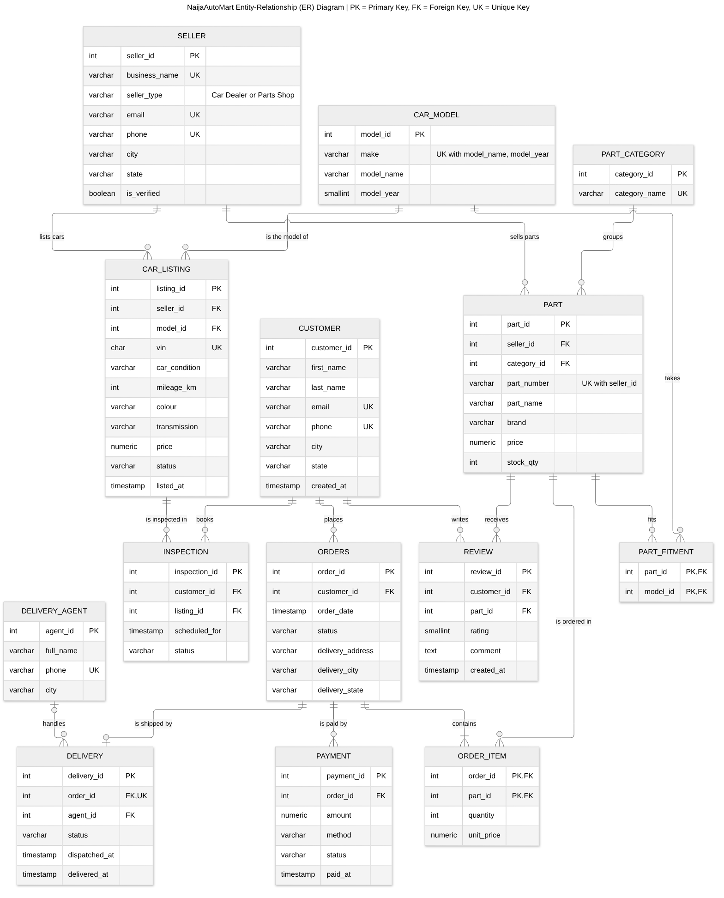
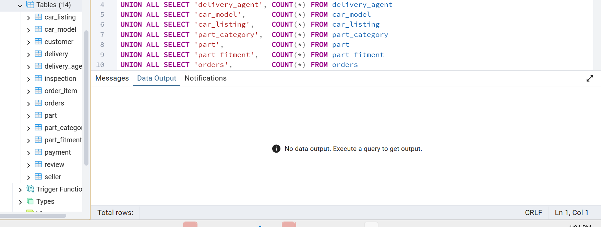
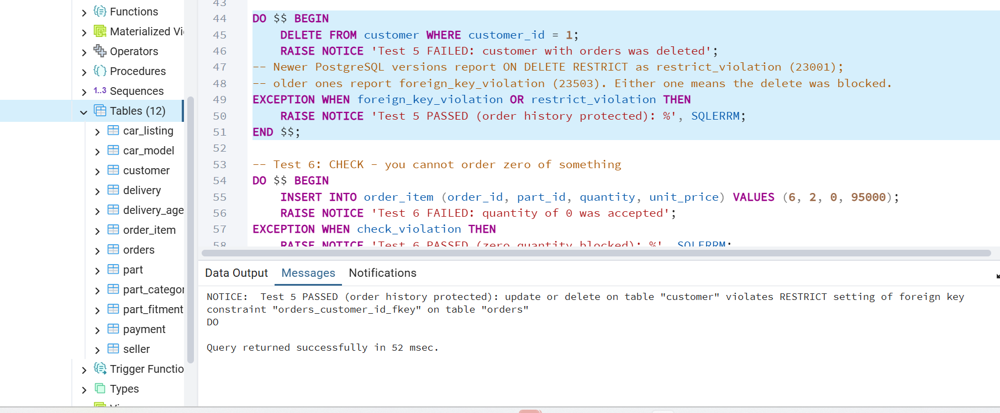
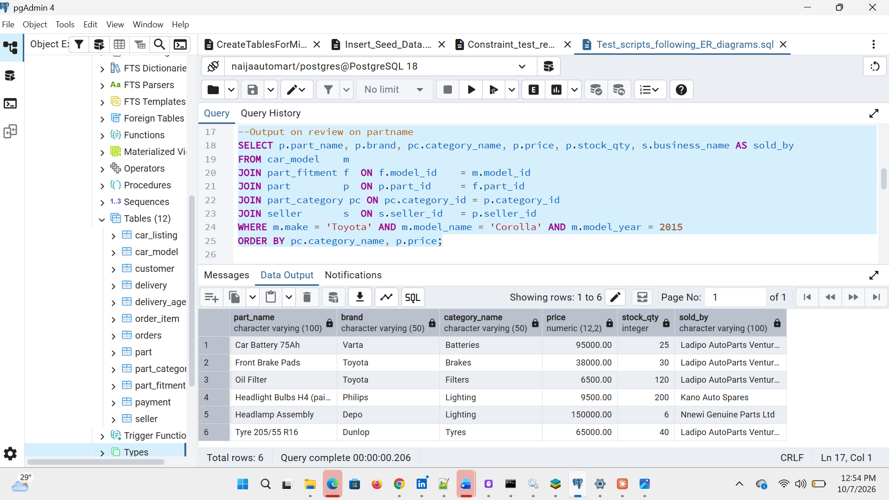

# Portfolio 1: Database Design and Modelling

**Adebajo Ayobamidele** · Student ID 301931278 · GitHub: [github.com/AyobamiAdebebajo95/advanced-database-portfolio](https://github.com/AyobamiAdebebajo95/advanced-database-portfolio)

This portfolio designs the relational database for **NaijaAutoMart**, a made-up Nigerian online store for cars and auto parts, and builds it in **PostgreSQL**. It was run on my own computer in PostgreSQL 18 with pgAdmin 4, and re-checked on PostgreSQL 16.

*Abbreviations are spelled out on first use. Full list: [abbreviations.md](../docs/abbreviations.md).*

| Required by the brief | Where to find it |
|---|---|
| Chosen case study description | [Main README](../README.md#1-selected-case-study-naijaautomart-online-store) and the summary below |
| ER (Entity-Relationship) diagram | [er-diagram.png](er-diagram.png) (shown below) |
| Relational schema | [Relational schema](#relational-schema) below, and [01_create_tables.sql](scripts/01_create_tables.sql) |
| Keys | [Keys and constraints](#keys-and-constraints) below |
| Constraints | [Keys and constraints](#keys-and-constraints), proved in [03_test_constraints.sql](scripts/03_test_constraints.sql) |
| Normalisation explanation | [normalisation.md](normalisation.md) |

---

## Case study in brief

NaijaAutoMart connects **car dealers** and **auto parts shops** with **customers** across Nigeria.
- **Cars:** dealers list cars for sale. Customers **book an inspection** before buying.
- **Parts:** shops sell parts online. Customers order them, pay, and a **delivery agent** brings them.
- Customers can check **which parts fit their car** and leave **reviews**.

---

## ER (Entity-Relationship) diagram



*Crow's foot notation. PK = Primary Key, FK = Foreign Key, UK = Unique Key. Source: [er-diagram.mmd](er-diagram.mmd). It can be edited at [mermaid.live](https://mermaid.live), or imported into draw.io under Arrange → Insert → Advanced → Mermaid.*

### How to read the relationships

| Type | Example | Meaning |
|---|---|---|
| One-to-many | CUSTOMER → ORDERS | One customer places many orders; each order belongs to one customer |
| Many-to-many | ORDERS ↔ PART (through **ORDER_ITEM**) | An order has many parts; a part appears in many orders |
| Many-to-many | PART ↔ CAR_MODEL (through **PART_FITMENT**) | A battery fits many cars; a car takes many parts |
| One-to-one | ORDERS → DELIVERY | Each order has at most one delivery (`UNIQUE` on `delivery.order_id`) |
| Optional | DELIVERY_AGENT → DELIVERY | A new delivery may not have an agent assigned yet (agent_id can be empty) |

A relational database can't store many-to-many links directly, so each one gets a **bridge table** (ORDER_ITEM, PART_FITMENT) with a two-column primary key.

---

## Relational schema

PK = Primary Key, FK = Foreign Key (→ the table it points to)

1. **CUSTOMER** (customer_id PK, first_name, last_name, email, phone, city, state, created_at)
2. **SELLER** (seller_id PK, business_name, seller_type, email, phone, city, state, is_verified)
3. **DELIVERY_AGENT** (agent_id PK, full_name, phone, city)
4. **CAR_MODEL** (model_id PK, make, model_name, model_year)
5. **CAR_LISTING** (listing_id PK, seller_id FK → SELLER, model_id FK → CAR_MODEL, vin, car_condition, mileage_km, colour, transmission, price, status, listed_at)
6. **PART_CATEGORY** (category_id PK, category_name)
7. **PART** (part_id PK, seller_id FK → SELLER, category_id FK → PART_CATEGORY, part_number, part_name, brand, price, stock_qty)
8. **PART_FITMENT** (part_id PK, FK → PART, model_id PK, FK → CAR_MODEL)
9. **ORDERS** (order_id PK, customer_id FK → CUSTOMER, order_date, status, delivery_address, delivery_city, delivery_state)
10. **ORDER_ITEM** (order_id PK, FK → ORDERS, part_id PK, FK → PART, quantity, unit_price)
11. **PAYMENT** (payment_id PK, order_id FK → ORDERS, amount, method, status, paid_at)
12. **DELIVERY** (delivery_id PK, order_id FK → ORDERS, agent_id FK → DELIVERY_AGENT, status, dispatched_at, delivered_at)
13. **INSPECTION** (inspection_id PK, customer_id FK → CUSTOMER, listing_id FK → CAR_LISTING, scheduled_for, status)
14. **REVIEW** (review_id PK, customer_id FK → CUSTOMER, part_id FK → PART, rating, comment, created_at)

---

## Keys and constraints

| Type | What it does | Examples in NaijaAutoMart |
|---|---|---|
| **Primary key** | Gives every row a unique ID (identifier) | `customer_id`, `part_id`; composite `(order_id, part_id)` in ORDER_ITEM |
| **Foreign key** | Links to a real row in another table | An order's `customer_id` must exist in CUSTOMER |
| **UNIQUE** | No duplicates allowed | Customer email and phone; car VIN (Vehicle Identification Number); one review per customer per part; no double-booking a car inspection |
| **NOT NULL** | Value must be filled in | Every car must have a VIN, price and condition |
| **CHECK** | Value must follow a rule | Price > 0; stock ≥ 0; rating 1–5; seller type is "Car Dealer" or "Parts Shop" |
| **DEFAULT** | Fills a value automatically | `order_date` = now; new orders start as 'Pending' |

### What happens when a linked row is deleted

| Rule | Used for | Why |
|---|---|---|
| `ON DELETE RESTRICT` | customer → orders, part → order items, order → payments | Order and payment history must never vanish |
| `ON DELETE CASCADE` | order → order items, part → fitment, customer → reviews | Child rows mean nothing without the parent |
| `ON DELETE SET NULL` | delivery agent → delivery | If an agent leaves, the delivery stays and simply has no agent |

### Proof the constraints work
[03_test_constraints.sql](scripts/03_test_constraints.sql) tries to save 12 kinds of bad data. **All 12 were blocked.** Full output: [evidence/03_constraint_test_results.txt](evidence/03_constraint_test_results.txt)

```
Test 1  PASSED (duplicate email blocked)
Test 2  PASSED (negative stock blocked)
Test 3  PASSED (rating 6 blocked)
Test 4  PASSED (unknown customer blocked)
Test 5  PASSED (order history protected)
Test 6  PASSED (zero quantity blocked)
Test 7  PASSED (duplicate fitment blocked)
Test 8  PASSED (second delivery blocked)
Test 9  PASSED (invalid seller type blocked)
Test 10 PASSED (missing VIN blocked)
Test 11 PASSED (impossible delivery date blocked)
Test 12 PASSED (double booking blocked)
```

---

## Normalisation

The tables are in **Third Normal Form (3NF)** and also pass the **Boyce-Codd Normal Form (BCNF)** check. [normalisation.md](normalisation.md) walks through a real order step by step, from one messy row through First (1NF), Second (2NF) and Third Normal Form (3NF), and explains the design choices that look like repetition but are deliberate (such as keeping `unit_price` on each order item).

---

## How to run it (pgAdmin)

1. Open **pgAdmin**, right-click the `naijaautomart` database and choose **Query Tool**.
2. Open each script with the folder icon and press **F5** (Run), in this order:

| Order | Script | What it does |
|---|---|---|
| 1 | [01_create_tables.sql](scripts/01_create_tables.sql) | Creates the 14 tables using SQL (Structured Query Language); safe to re-run |
| 2 | [02_insert_sample_data.sql](scripts/02_insert_sample_data.sql) | Adds sample customers, sellers, cars, parts and orders |
| 3 | [03_test_constraints.sql](scripts/03_test_constraints.sql) | Tests the rules; results appear in the **Messages** tab |
| 4 | [04_check_queries.sql](scripts/04_check_queries.sql) | Five queries (Q1–Q5) showing the design works |

## Evidence

All screenshots were taken in pgAdmin 4 on my own computer (PostgreSQL 18) on 7 October 2026.

### 1. Tables created (script 01)



| Screenshot | Shows |
|---|---|
| [01a_create_order_item_table.png](evidence/screenshots/01a_create_order_item_table.png) | ORDER_ITEM created with its composite primary key and CHECK rules |
| [01b_create_payment_table.png](evidence/screenshots/01b_create_payment_table.png) | PAYMENT created with CHECK rules on amount, method and status |
| [01c_create_delivery_table.png](evidence/screenshots/01c_create_delivery_table.png) | DELIVERY created; UNIQUE order_id makes it one-to-one |
| [01d_create_inspection_table.png](evidence/screenshots/01d_create_inspection_table.png) | INSPECTION created with the no-double-booking UNIQUE rule |
| [01e_create_review_table.png](evidence/screenshots/01e_create_review_table.png) | REVIEW created with rating 1–5 CHECK |
| [01h_all_14_tables_in_pgadmin.png](evidence/screenshots/01h_all_14_tables_in_pgadmin.png) | pgAdmin showing all 14 tables, including INSPECTION and REVIEW |

### 2. Sample data loaded (script 02)

| Screenshot | Shows |
|---|---|
| [02_insert_sample_data.png](evidence/screenshots/02_insert_sample_data.png) | Inspection bookings and reviews inserted successfully (`INSERT 0 5`) |

### 3. Constraint tests (script 03)



| Test | Rule tested | Screenshot |
|---|---|---|
| 1 | UNIQUE: duplicate email blocked | [03_test01](evidence/screenshots/03_test01_duplicate_email_blocked.png) |
| 2 | CHECK: negative stock blocked | [03_test02](evidence/screenshots/03_test02_negative_stock_blocked.png) |
| 3 | CHECK: rating of 6 blocked | [03_test03](evidence/screenshots/03_test03_rating_6_blocked.png) |
| 4 | FOREIGN KEY: order for unknown customer blocked | [03_test04](evidence/screenshots/03_test04_unknown_customer_blocked.png) |
| 5 | ON DELETE RESTRICT: order history protected | [03_test05](evidence/screenshots/03_test05_order_history_protected.png) |
| 6 | CHECK: zero quantity blocked | [03_test06](evidence/screenshots/03_test06_zero_quantity_blocked.png) |
| 7 | Composite PRIMARY KEY: duplicate fitment blocked | [03_test07](evidence/screenshots/03_test07_duplicate_fitment_blocked.png) |
| 8 | UNIQUE (one-to-one): second delivery blocked | [03_test08](evidence/screenshots/03_test08_second_delivery_blocked.png) |
| 9 | CHECK: invalid seller type blocked | [03_test09](evidence/screenshots/03_test09_invalid_seller_type_blocked.png) |
| 10 | NOT NULL: missing VIN (Vehicle Identification Number) blocked | [03_test10](evidence/screenshots/03_test10_missing_vin_blocked.png) |
| 11 | CHECK: delivered-before-dispatched blocked | [03_test11](evidence/screenshots/03_test11_impossible_delivery_date_blocked.png) |
| 12 | UNIQUE: double-booked inspection blocked | [03_test12](evidence/screenshots/03_test12_double_booking_blocked.png) |

### 4. Queries (script 04)



| Query | Shows | Screenshot |
|---|---|---|
| Q1 | Row count for every table | [04_q1_row_counts.png](evidence/screenshots/04_q1_row_counts.png) |
| Q2 | Parts that fit a 2015 Toyota Corolla (uses the PART_FITMENT bridge table) | [04_q2_parts_that_fit_corolla_2015.png](evidence/screenshots/04_q2_parts_that_fit_corolla_2015.png) |
| Q3 | Cars available for sale with dealer and city | [04_q3_available_cars.png](evidence/screenshots/04_q3_available_cars.png) |
| Q4 | Order totals calculated from order items | [04_q4_order_summary.png](evidence/screenshots/04_q4_order_summary.png) |
| Q5 | Average rating per part | [04_q5_part_ratings.png](evidence/screenshots/04_q5_part_ratings.png) |

### Text outputs

| File | Shows |
|---|---|
| [01_tables_and_constraints.txt](evidence/01_tables_and_constraints.txt) | All 14 tables and every key and constraint, listed by PostgreSQL |
| [03_constraint_test_results.txt](evidence/03_constraint_test_results.txt) | All 12 constraint tests passing in one run |
| [04_query_results.txt](evidence/04_query_results.txt) | Full results of Q1–Q5 |
