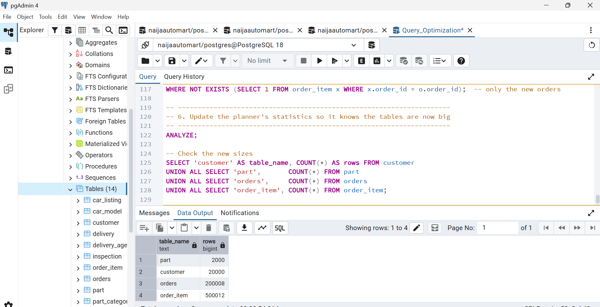
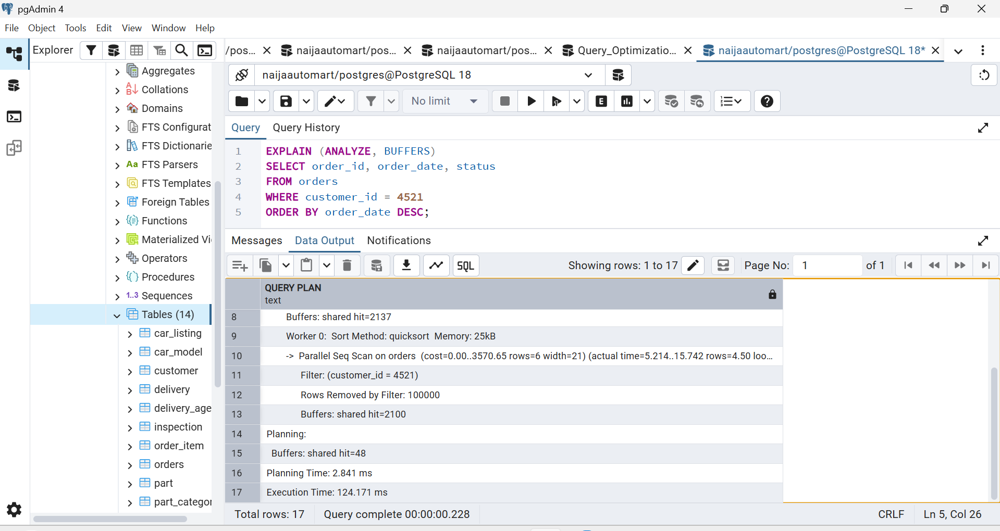
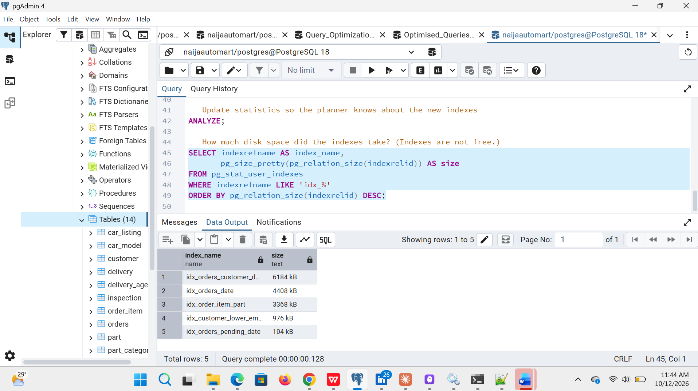
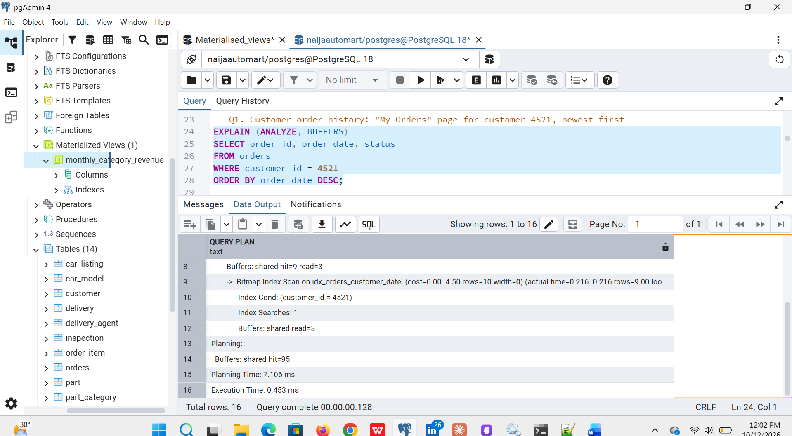
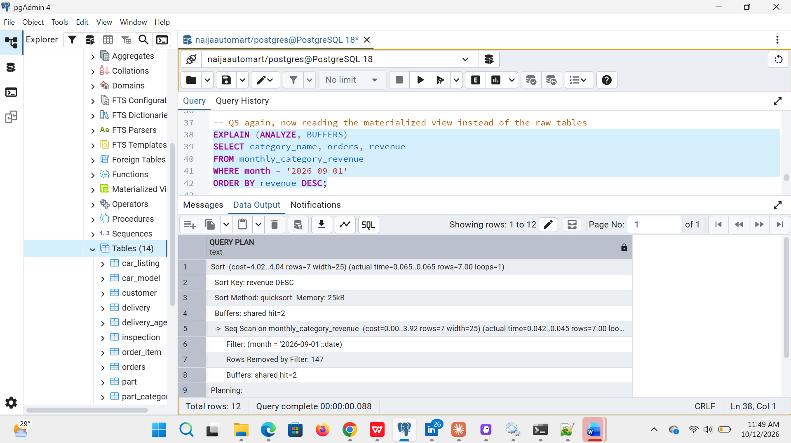

# Portfolio 2: Query Processing and Optimisation

This portfolio takes five real NaijaAutoMart business queries, measures how PostgreSQL runs them on a large amount of data, and makes them faster with indexes and a materialized view. It also measures the cost of those indexes.

*Abbreviations are spelled out on first use. Full list: [abbreviations.md](../docs/abbreviations.md).*

| Required by the brief | Where to find it |
|---|---|
| SQL queries | [02_explain_queries.sql](scripts/02_explain_queries.sql) (Q1–Q6) |
| Query results | [04_materialized_view_output.txt](evidence/04_materialized_view_output.txt) and screenshots |
| Execution plans | [02_plans_before.txt](evidence/02_plans_before.txt) and [02_plans_after.txt](evidence/02_plans_after.txt) |
| Indexing / optimisation evidence | [03_create_indexes.sql](scripts/03_create_indexes.sql), [04_materialized_view.sql](scripts/04_materialized_view.sql) |
| Brief performance analysis | [Results](#results) and [What the plans show](#what-the-plans-show) below |

---

## The data

Indexes only matter when tables are big. [01_generate_large_data.sql](scripts/01_generate_large_data.sql) adds realistic data to the Portfolio 1 database using plain SQL (Structured Query Language), so nothing extra needs installing:

| Table | Rows |
|---|---|
| customer | 20,000 |
| part | 2,000 |
| orders | 200,008 (January 2025 to October 2026) |
| order_item | 500,012 |

`setseed()` makes the "random" data the same every time, so the results can be repeated.

---

## How a query is processed

When a query is sent, PostgreSQL:
1. **Parses** it: checks the SQL is valid.
2. **Plans** it: the *query planner* works out several ways to get the answer and picks the one it estimates is cheapest.
3. **Executes** the plan.

`EXPLAIN ANALYZE` shows the plan it picked and how long each step really took. The main words to look for:

| Plan step | Meaning |
|---|---|
| **Seq Scan** (Sequential Scan) | Reads **every** row in the table. Fine for small tables, slow for big ones |
| **Index Scan** | Uses an index to jump straight to the matching rows |
| **Bitmap Index Scan + Bitmap Heap Scan** | Uses an index to list many matching rows, then fetches them page by page |
| **Rows Removed by Filter** | Rows that were read and then thrown away: wasted work |
| **Buffers: shared hit** | Number of 8 KB (kilobyte) pages read. Fewer is better |

---

## Results

Each query was run once to warm up, then 3 more times. The middle (median) time is shown. Times are in ms (milliseconds).

| Query | What it does | Before | After | Change | Technique used |
|---|---|---|---|---|---|
| **Q1** | A customer's order history, newest first | 10.83 ms | 0.21 ms | **~50× faster** | Composite index `(customer_id, order_date)` |
| **Q2** | Admin list of pending orders | 15.05 ms | 5.21 ms | **~3× faster** | Partial index (only Pending orders) |
| **Q3** | Login by email, ignoring capital letters | 11.39 ms | 0.02 ms | **~500× faster** | Expression index on `lower(email)` |
| **Q4** | Every sale of one part | 22.30 ms | 1.72 ms | **~13× faster** | Index on the foreign key `order_item.part_id` |
| **Q5** | Revenue by category for September 2026 | 84.29 ms | 86.88 ms | **No real change** | Index on `order_date` (did not help enough) |
| **Q5** | …using a materialized view instead | 84.29 ms | 0.09 ms | **~1000× faster** | Materialized view (pre-calculated summary) |
| **Q6** | Insert 10,000 new orders | 80.75 ms | 109.14 ms | **~35% slower** | Cost of keeping 5 extra indexes updated |

The five indexes take about **15 MB** of disk space. Full timings: [timing_summary.txt](evidence/timing_summary.txt).

---

## What the plans show

**Q1: customer order history (composite index)**
- *Before:* `Parallel Seq Scan on orders`. PostgreSQL read all 200,008 orders to find customer 4521's 10, with `Rows Removed by Filter: 99999` in each of its 2 parallel processes. That's 2,239 pages read.
- *After:* `Bitmap Index Scan on idx_orders_customer_date` went straight to the 10 orders, reading only **17 pages**.
- *Why it works:* the index is sorted by customer, then date, like a phone book sorted by surname, then first name.

**Q2: pending orders (partial index)**
- *Before:* `Seq Scan on orders`, which read 200,008 rows and threw away 196,162 to keep the 3,846 pending ones.
- *After:* `Bitmap Index Scan on idx_orders_pending_date`. The index is tiny (104 KB) because it only stores Pending orders.
- *Why only 3×:* the 3,846 pending orders are scattered all over the table, so PostgreSQL still had to visit 1,759 of the 2,203 pages to fetch them. An index helps most when it leads to a **small** number of rows.

**Q3: login by email (expression index)**
- *Before:* `Seq Scan on customer`, which read all 20,000 customers to find 1 (`Rows Removed by Filter: 19999`). The existing UNIQUE index on `email` **could not be used**, because the query searches `lower(email)`, not `email`.
- *After:* `Index Scan using idx_customer_lower_email`, reading **3 pages instead of 271**.
- *Lesson:* an index only helps if the query searches the exact same thing the index stores.

**Q4: sales of one part (foreign key index)**
- *Before:* `Parallel Seq Scan on order_item`, which read all 500,012 order items to find the 200 for part 250.
- *After:* `Bitmap Index Scan on idx_order_item_part`.
- *Lesson:* PostgreSQL automatically indexes primary keys and UNIQUE columns, **but not foreign keys**. The primary key `(order_id, part_id)` can't help a search on `part_id` alone, because `part_id` is its second column.

**Q5: monthly report (where an index was not enough)**
- *After the index:* PostgreSQL now finds September's orders with `Bitmap Index Scan on idx_orders_date`, but it still does a `Parallel Seq Scan on order_item` (all 500,012 rows) to join them. The slow part simply moved.
- *Fix:* [04_materialized_view.sql](scripts/04_materialized_view.sql) calculates revenue for every month and category **once** and saves the 154-row result. The report then reads just those rows: **0.09 ms**, with exactly the same answer as the original query.
- *Trade-off:* a materialized view doesn't update by itself. It must be refreshed, for example every night. That's fine for monthly reports, but not for live data like stock levels.

**Q6: the cost of indexes**
- Inserting 10,000 orders took **~35% longer** after the indexes were added, because each new row must also be written into every index on the table.
- *Lesson:* add indexes for the queries that really need them, not on every column. NaijaAutoMart reads orders far more often than it creates them, so this trade-off is worth it.

---

## How to run it (pgAdmin)

Run the Portfolio 1 scripts 01 and 02 first. Then, in the Query Tool, run each script with **nothing highlighted** and press **F5**:

| Order | Script | What it does |
|---|---|---|
| 1 | [01_generate_large_data.sql](scripts/01_generate_large_data.sql) | Adds the large data (about 30–60 seconds) |
| 2 | [02_explain_queries.sql](scripts/02_explain_queries.sql) | **Before** results: plans and times for Q1–Q6 |
| 3 | [03_create_indexes.sql](scripts/03_create_indexes.sql) | Creates the 5 indexes and shows their sizes |
| 4 | [02_explain_queries.sql](scripts/02_explain_queries.sql) | **After** results: run the same script again |
| 5 | [04_materialized_view.sql](scripts/04_materialized_view.sql) | Builds the materialized view for Q5 |

Tip: in pgAdmin, put the cursor on one query and press **F7** to see its plan as a picture. Times will differ on each computer, but the **plan changes** (Seq Scan → Index Scan) should be the same.

---

## Evidence

### Screenshots from my own computer (pgAdmin 4, PostgreSQL 18, 12 October 2026)

The plan shapes match the test run above. Times are different because every computer is different.

**1. Large data loaded (script 01)**

| Screenshot | Shows |
|---|---|
| [01a_generate_data_start_and_row_counts.png](evidence/screenshots/01a_generate_data_start_and_row_counts.png) | Start of the script and the final row counts |
| [01b_generate_data_real_id_lookup.png](evidence/screenshots/01b_generate_data_real_id_lookup.png) | The script looking up real seller IDs (the fix for the ID gap bug) |
| [01c_generate_data_finished_row_counts.png](evidence/screenshots/01c_generate_data_finished_row_counts.png) | 2,000 parts, 20,000 customers, 200,008 orders, 500,012 order items |

**2. BEFORE indexes (script 02, first run)**

| Query | Screenshot | What it shows |
|---|---|---|
| Q1 | [02_before_q1_plan_top.png](evidence/screenshots/02_before_q1_plan_top.png), [02_before_q1_seq_scan.png](evidence/screenshots/02_before_q1_seq_scan.png) | `Parallel Seq Scan on orders`, 100,000 rows removed per process, **124 ms** on my PC |
| Q2 | [02_before_q2_seq_scan.png](evidence/screenshots/02_before_q2_seq_scan.png) | `Seq Scan on orders`, 196,162 rows removed to find 3,846 pending orders |
| Q3 | [02_before_q3_seq_scan.png](evidence/screenshots/02_before_q3_seq_scan.png) | `Seq Scan on customer`, 19,999 rows removed to find 1, **18.3 ms** on my PC |
| Q4 | [02_before_q4_plan.png](evidence/screenshots/02_before_q4_plan.png) | Parallel plan reading 4,000 pages to find 200 sales of one part |
| Q5 | [02_before_q5_plan.png](evidence/screenshots/02_before_q5_plan.png) | Hash joins over the full order and order item tables |
| Q6 | [02_before_q6_insert_rolled_back.png](evidence/screenshots/02_before_q6_insert_rolled_back.png) | 10,000-order insert test, rolled back so nothing is kept |

**3. Indexes created (script 03)**

| Screenshot | Shows |
|---|---|
| [03a_index_customer_date.png](evidence/screenshots/03a_index_customer_date.png) | Composite index for Q1 |
| [03b_index_pending_partial.png](evidence/screenshots/03b_index_pending_partial.png) | Partial index for Q2 |
| [03c_index_lower_email.png](evidence/screenshots/03c_index_lower_email.png) | Expression index for Q3 |
| [03d_index_order_item_part.png](evidence/screenshots/03d_index_order_item_part.png) | Foreign key index for Q4 |
| [03e_index_orders_date.png](evidence/screenshots/03e_index_orders_date.png) | Date index for Q5 |
| [03f_analyze.png](evidence/screenshots/03f_analyze.png) | `ANALYZE` updating the planner's statistics |
| [03g_index_sizes.png](evidence/screenshots/03g_index_sizes.png) | Index sizes: 6,184 KB down to 104 KB |

**4. AFTER indexes (script 02, second run)**

| Query | Screenshot | What it shows |
|---|---|---|
| Q1 | [02_after_q1_index_scan.png](evidence/screenshots/02_after_q1_index_scan.png) | `Bitmap Index Scan on idx_orders_customer_date`, only **3 pages** read from the index, **0.45 ms** |
| Q2 | [02_after_q2_partial_index.png](evidence/screenshots/02_after_q2_partial_index.png) | `Bitmap Index Scan on idx_orders_pending_date` finds the 3,846 pending orders, but still visits 1,747 table pages (they are scattered) |
| Q3 | [02_after_q3_expression_index.png](evidence/screenshots/02_after_q3_expression_index.png) | `Index Scan using idx_customer_lower_email`, **3 pages**, **0.20 ms** |
| Q4 | [02_after_q4_part_index.png](evidence/screenshots/02_after_q4_part_index.png) | 200 sales found through the new index, **3.0 ms** |
| Q5 | [02_after_q5_still_slow.png](evidence/screenshots/02_after_q5_still_slow.png) | Still slow (**359 ms**): the index alone was not enough, which is why the materialized view was needed |

**On my own PC (PostgreSQL 18)**, from the screenshots above:

| Query | Before | After | Change |
|---|---|---|---|
| Q1 Customer order history | 124.17 ms | 0.45 ms | ~270× faster |
| Q3 Login by email | 18.33 ms | 0.20 ms | ~90× faster |
| Q5 from the materialized view | – | 0.065 ms | (see section 5) |

The exact times differ from the test run, as expected on a different computer, but the plan changes are identical.

**5. Materialized view for Q5 (script 04)**

| Screenshot | Shows |
|---|---|
| [04a_create_materialized_view.png](evidence/screenshots/04a_create_materialized_view.png) | View created: 154 summary rows |
| [04b_materialized_view_index.png](evidence/screenshots/04b_materialized_view_index.png) | Index on the view's month column |
| [04c_q5_materialized_view_plan.png](evidence/screenshots/04c_q5_materialized_view_plan.png) | Q5 now reads **2 pages** and finishes in **0.065 ms** |
| [04d_q5_materialized_view_result.png](evidence/screenshots/04d_q5_materialized_view_result.png) | September 2026 revenue by category; the view appears in pgAdmin |

### Text outputs from the test run

| File | Shows |
|---|---|
| [01_generate_large_data_output.txt](evidence/01_generate_large_data_output.txt) | Row counts after loading the data |
| [02_plans_before.txt](evidence/02_plans_before.txt) | Full execution plans **before** indexes |
| [03_create_indexes_output.txt](evidence/03_create_indexes_output.txt) | Indexes created, with sizes |
| [02_plans_after.txt](evidence/02_plans_after.txt) | Full execution plans **after** indexes |
| [04_materialized_view_output.txt](evidence/04_materialized_view_output.txt) | Q5 from the materialized view, with the result |
| [timing_summary.txt](evidence/timing_summary.txt) | Median times before and after |

*The plan files are from one run, so their times differ slightly from the medians above.*
