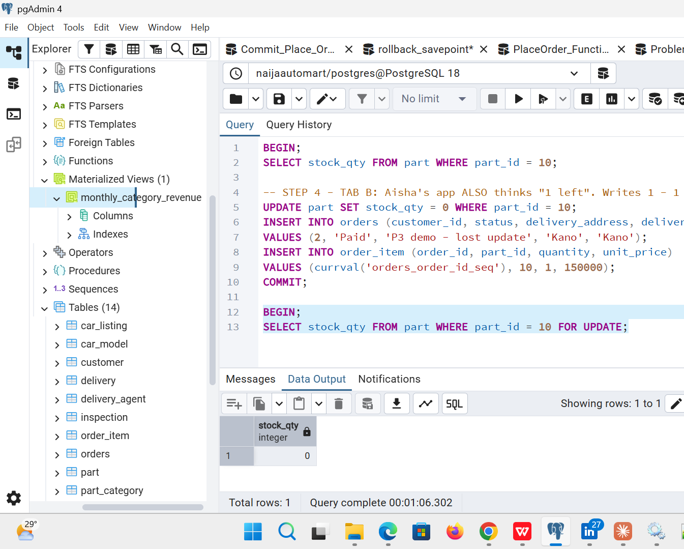
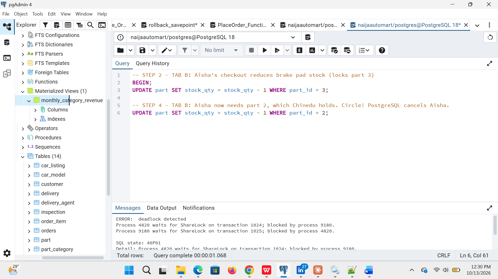

# Portfolio 3: Transactions and Concurrency

This portfolio shows how NaijaAutoMart keeps its data correct when an order touches several tables at once, and when many customers shop **at the same time**. The main example is two customers trying to buy the **last headlamp** at the same moment.

*Abbreviations are spelled out on first use. Full list: [abbreviations.md](../docs/abbreviations.md).*

| Required by the brief | Where to find it |
|---|---|
| Commit | [01_commit_place_order.sql](scripts/01_commit_place_order.sql) |
| Rollback | [02_rollback_and_savepoint.sql](scripts/02_rollback_and_savepoint.sql), [03_place_order_function.sql](scripts/03_place_order_function.sql) |
| Isolation | [07_isolation_levels.sql](scripts/07_isolation_levels.sql) |
| Concurrency issue | [04_problem_lost_update.sql](scripts/04_problem_lost_update.sql) (overselling), [08_deadlock.sql](scripts/08_deadlock.sql) |
| Control mechanism | [05_fix_select_for_update.sql](scripts/05_fix_select_for_update.sql), [06_fix_atomic_update.sql](scripts/06_fix_atomic_update.sql), lock ordering in [08_deadlock.sql](scripts/08_deadlock.sql) |
| Screenshots / output evidence | [evidence/](evidence/), one output file per script |

---

## What is a transaction?

A **transaction** is a group of database changes that must **all succeed or all fail together**. Placing a NaijaAutoMart order changes four tables: ORDERS, ORDER_ITEM, PART (stock) and PAYMENT. If the stock went down but the order was never saved, the business would lose a part with no record of who has it.

```
BEGIN;      -- start
  ...4 changes...
COMMIT;     -- save all of them     (or ROLLBACK; to cancel all of them)
```

### ACID: the four promises a transaction makes

| Letter | Stands for | Meaning | NaijaAutoMart example |
|---|---|---|---|
| **A** | Atomicity | All or nothing | A declined card cancels the order, the items **and** the stock change ([script 02](scripts/02_rollback_and_savepoint.sql)) |
| **C** | Consistency | Rules are never broken | The `CHECK (stock_qty >= 0)` rule from Portfolio 1 means stock can never go negative |
| **I** | Isolation | Transactions running together don't interfere | Two customers buying the last headlamp can't both get it ([scripts 05–06](scripts/05_fix_select_for_update.sql)) |
| **D** | Durability | Once committed, it stays saved | A committed order survives even if the server restarts a second later |

---

## Results

| # | Scenario | Isolation level | What happened | Control mechanism | Result |
|---|---|---|---|---|---|
| 01 | Tunde orders a battery + bulbs | READ COMMITTED (default) | All 4 tables updated | `BEGIN … COMMIT` | Stock 25→24 and 200→198; order + payment saved |
| 02a | Segun's card is declined | READ COMMITTED | Stock dropped to 14 **inside** the transaction | `ROLLBACK` | Stock back to 15, order count unchanged |
| 02b | Ngozi adds an out-of-stock item | READ COMMITTED | Second item inserted | `SAVEPOINT` + `ROLLBACK TO SAVEPOINT` | Order saved with **1** item, not 2 |
| 03 | Order for out-of-stock part via `place_order()` | READ COMMITTED | Function raised "Not enough stock" | Function = one transaction | Orders and payments counts unchanged |
| 04 | **Two buyers, last headlamp** | READ COMMITTED | Both read "1 in stock" | **None** | ❌ **2 sold, only 1 existed** (lost update) |
| 05 | Two buyers, last headlamp | READ COMMITTED | Aisha **waited** for Chinedu's lock, then saw 0 | `SELECT … FOR UPDATE` | ✅ 1 sold, stock 0 |
| 06 | Two buyers, last headlamp | READ COMMITTED | Aisha waited, then got `UPDATE 0` | `UPDATE … WHERE stock_qty >= 1` | ✅ 1 sold, stock 0 |
| 07a | Admin edits price, not yet saved | READ UNCOMMITTED requested | Other tab still saw ₦95,000 | PostgreSQL never allows dirty reads | ✅ No dirty read |
| 07b | Admin saves a new price during checkout | READ COMMITTED | Same query gave ₦95,000 then ₦99,000 | None | ⚠️ Non-repeatable read |
| 07c | Admin saves a new price during checkout | REPEATABLE READ | Checkout saw ₦95,000 both times | Snapshot | ✅ Repeatable; a conflicting update was refused (error 40001) |
| 08a | Opposite baskets lock parts 2↔3 | READ COMMITTED | Each waited for the other | PostgreSQL deadlock detection | ⚠️ "deadlock detected" (error 40P01); one buyer cancelled |
| 08b | Same baskets, locked in `part_id` order | READ COMMITTED | Second buyer simply waited | Consistent lock order | ✅ No deadlock |

Full output of every step: [evidence/](evidence/).

---

## What the results show

**The problem: lost update (script 04).** Both apps read "1 in stock" before either wrote anything. Each then wrote `stock = 0` based on its **old** reading, and Aisha's write silently replaced Chinedu's. The default READ COMMITTED level does not stop this, because each statement on its own was valid.

**Fix 1: `SELECT … FOR UPDATE` (script 05), "pessimistic locking".** Reading with `FOR UPDATE` **locks** the row. Aisha's read had to wait until Chinedu committed, and then it returned the **true** stock: 0. This is what the `place_order()` function in script 03 does.

**Fix 2: atomic conditional update (script 06).** `UPDATE part SET stock_qty = stock_qty - 1 WHERE part_id = 10 AND stock_qty >= 1` checks and changes the stock in one step. Aisha's update waited, re-checked the condition on the new value (0), and changed **0 rows**. It's simpler than Fix 1 and needs no separate read.

**Which fix would I use?** Fix 2 for a simple stock decrease, because it's one statement with the shortest lock time. Fix 1 (inside `place_order()`) when the app must read several values, such as price and stock, before deciding.

**Isolation levels (script 07).**
- PostgreSQL **never** shows uncommitted data. Asking for READ UNCOMMITTED gives READ COMMITTED behaviour.
- READ COMMITTED (the default) showed a **different price** the second time inside the same checkout. A customer could be charged a price they never saw.
- REPEATABLE READ kept the original ₦95,000 for the whole checkout. When the checkout tried to update a row that someone else had changed, PostgreSQL refused with *"could not serialize access due to concurrent update"*. The app should catch this and **retry**.
- SERIALIZABLE (not demonstrated) is stricter still: it makes transactions behave as if they ran one after another.

**Deadlock (script 08).** Chinedu locked part 2 then wanted part 3; Aisha locked part 3 then wanted part 2. PostgreSQL detected the circle after about 1 second and cancelled one transaction, usually the one that started waiting **last** (Tab B). The fix is to always lock parts in the **same order** (lowest `part_id` first), so the second buyer simply waits and a circle can never form.

**Small detail: order numbers can have gaps.** In script 02 the cancelled order used order number 200010, so the next saved order became 200011. Sequences are never rolled back, to keep them fast when many people order at once.

---

## How to run it (pgAdmin)

Run on the `naijaautomart` database after Portfolio 1 (the Portfolio 2 data is optional).

**Scripts 01–03 (one tab):** open a Query Tool tab, highlight each `STEP` and press **F5**. If you run a whole file at once, pgAdmin only shows the last result.

**Scripts 04–08 (two tabs):**
1. Open **two** Query Tool tabs on `naijaautomart`. Call them **Tab A** and **Tab B**, and open the same script in both.
2. Run the `SETUP` step (if there is one), then each `STEP` **in the tab it names**, in number order.
3. When a step says it **WAITS**, that tab keeps spinning. That is the lock working. Switch to the other tab and run the next step.

| Order | Script | Tabs |
|---|---|---|
| 1 | [01_commit_place_order.sql](scripts/01_commit_place_order.sql) | 1 |
| 2 | [02_rollback_and_savepoint.sql](scripts/02_rollback_and_savepoint.sql) | 1 |
| 3 | [03_place_order_function.sql](scripts/03_place_order_function.sql) | 1 |
| 4 | [04_problem_lost_update.sql](scripts/04_problem_lost_update.sql) | 2 |
| 5 | [05_fix_select_for_update.sql](scripts/05_fix_select_for_update.sql) | 2 |
| 6 | [06_fix_atomic_update.sql](scripts/06_fix_atomic_update.sql) | 2 |
| 7 | [07_isolation_levels.sql](scripts/07_isolation_levels.sql) | 2 |
| 8 | [08_deadlock.sql](scripts/08_deadlock.sql) | 2 |

*If you see* `SET TRANSACTION ISOLATION LEVEL must be called before any query` *(error 25001):* that tab already had a transaction open, so the isolation level could not be changed. Run `ROLLBACK;` in that tab and try the step again. Also check that **Auto commit** is ticked in the Query Tool (the drop-down arrow next to the Run button); if it's off, pgAdmin quietly starts a transaction for you.

*Tip:* if pgAdmin's "auto-rollback on error" setting is on, it cancels the transaction for you after an error. A later `ROLLBACK` step may then just say "there is no transaction in progress", which is fine.

---

## Evidence

### Screenshots from my own computer (pgAdmin 4, PostgreSQL 18, 13 October 2026)

Each pgAdmin tab is one database connection, so **Tab A and Tab B are two separate users**. Note the query times in the waiting screenshots: they show how long a tab was blocked by the other tab's lock.

**The key moments**


*Fix 1: Aisha's `SELECT … FOR UPDATE` waited **1 min 6 s** for Chinedu's lock, then saw the true stock: **0**.*


*Deadlock: PostgreSQL cancelled Aisha's transaction after about 1 second (SQL state 40P01).*

| Script | Screenshot | What it shows |
|---|---|---|
| **01 Commit** | [01a](evidence/screenshots/01a_commit_before_stock.png) · [01b](evidence/screenshots/01b_commit_transaction.png) · [01c](evidence/screenshots/01c_commit_after_order_and_payment.png) | Stock 25 and 200 before; 4 changes committed together; order, items and ₦114,000 payment all saved |
| **02 Rollback** | [02a](evidence/screenshots/02a_rollback_before.png) · [02b](evidence/screenshots/02b_rollback_changes_inside_transaction.png) · [02c](evidence/screenshots/02c_rollback_stock_14_inside.png) · [02d](evidence/screenshots/02d_rollback_executed.png) · [02e](evidence/screenshots/02e_rollback_after_nothing_saved.png) | Battery stock 15 → **14 inside** the transaction → `ROLLBACK` → back to **15**, order count unchanged (200,009) |
| **02 Savepoint** | [02f](evidence/screenshots/02f_savepoint_order.png) · [02g](evidence/screenshots/02g_savepoint_one_item_kept.png) | Order saved with **1** item (the oil filter); the out-of-stock item was undone |
| **03 place_order()** | [03a](evidence/screenshots/03a_place_order_function_create.png) · [03b](evidence/screenshots/03b_place_order_stock_check_last.png) · [03c](evidence/screenshots/03c_place_order_good_order.png) · [03d](evidence/screenshots/03d_place_order_bad_order_rolled_back.png) | Good order → new order 210013; bad order refused, orders 200,011 → 200,011 and payments 10 → 10 (fully rolled back) |
| **04 Lost update (problem)** | [04a](evidence/screenshots/04a_lost_update_tabA_reads_1.png) · [04b](evidence/screenshots/04b_lost_update_tabB_also_reads_1.png) · [04c](evidence/screenshots/04c_lost_update_tabA_commits.png) · [04d](evidence/screenshots/04d_lost_update_tabB_commits.png) · [04e](evidence/screenshots/04e_lost_update_oversold_stock_0.png) | **Both tabs read 1**, both committed a sale; stock shows 0 but **2 headlamps were sold** |
| **05 Fix 1: FOR UPDATE** | [05a](evidence/screenshots/05a_for_update_setup.png) · [05b](evidence/screenshots/05b_for_update_tabA_locks_row.png) · [05c](evidence/screenshots/05c_for_update_tabA_commits.png) · [05d](evidence/screenshots/05d_for_update_tabB_waited_then_sees_0.png) · [05e](evidence/screenshots/05e_for_update_tabB_rollback.png) · [05f](evidence/screenshots/05f_for_update_one_sale_only.png) | Tab B **waited 1 min 6 s**, then saw 0; only 1 sale |
| **06 Fix 2: atomic update** | [06a](evidence/screenshots/06a_atomic_setup.png) · [06b](evidence/screenshots/06b_atomic_tabA_update_1.png) · [06c](evidence/screenshots/06c_atomic_tabA_commits.png) · [06d](evidence/screenshots/06d_atomic_tabB_waited_update_0.png) · [06e](evidence/screenshots/06e_atomic_tabB_rollback.png) | Tab A: `UPDATE 1`; Tab B **waited 29 s**, then `UPDATE 0` (sold out) |
| **07 Isolation** | [07a](evidence/screenshots/07a_isolation_setup.png) · [07b](evidence/screenshots/07b_tabA_uncommitted_price_change.png) · [07c](evidence/screenshots/07c_tabB_no_dirty_read.png) · [07d](evidence/screenshots/07d_tabA_rollback.png) | No dirty read: Tab B never saw the uncommitted price of ₦1 |
| | [07e](evidence/screenshots/07e_read_committed_first_read_95000.png) · [07f](evidence/screenshots/07f_tabB_raises_price_99000.png) · [07g](evidence/screenshots/07g_read_committed_second_read.png) | READ COMMITTED: first read ₦95,000, then the admin saves ₦99,000 |
| | [07h](evidence/screenshots/07h_error_25001_isolation_after_query.png) | My mistake: error 25001, an isolation level set after a query had already run (see the reflection log) |
| | [07i](evidence/screenshots/07i_repeatable_read_first_read_95000.png) · [07j](evidence/screenshots/07j_tabB_raises_price_again.png) · [07k](evidence/screenshots/07k_repeatable_read_still_95000.png) | REPEATABLE READ: still **₦95,000** after the admin changed it |
| | [07l](evidence/screenshots/07l_error_40001_serialization.png) · [07m](evidence/screenshots/07m_rollback_after_40001.png) · [07n](evidence/screenshots/07n_price_restored.png) | Update refused: *could not serialize access due to concurrent update* (40001) |
| **08 Deadlock** | [08a](evidence/screenshots/08a_deadlock_tabA_locks_part2.png) · [08b](evidence/screenshots/08b_deadlock_detected_40P01.png) · [08c](evidence/screenshots/08c_deadlock_details.png) · [08d](evidence/screenshots/08d_tabA_finished_after_deadlock.png) · [08e](evidence/screenshots/08e_tabB_rollback.png) | Deadlock detected (40P01), with the two processes waiting on each other; Tab A then finished |
| **08 Lock-order fix** | [08f](evidence/screenshots/08f_lock_order_tabA_locks_both.png) · [08g](evidence/screenshots/08g_lock_order_tabB_waited_no_deadlock.png) · [08h](evidence/screenshots/08h_lock_order_tabB_finish.png) | Same baskets locked in `part_id` order: Tab B simply **waited 49.8 s**, no deadlock |

### Text outputs from the test run

Each file shows every step, which tab ran it, the time it ran, and the result.

| File | Shows |
|---|---|
| [01_commit_place_order_output.txt](evidence/01_commit_place_order_output.txt) | Stock and order before/after COMMIT |
| [02_rollback_and_savepoint_output.txt](evidence/02_rollback_and_savepoint_output.txt) | ROLLBACK leaves nothing behind; SAVEPOINT keeps part of an order |
| [03_place_order_function_output.txt](evidence/03_place_order_function_output.txt) | Good order placed; bad order fully rolled back |
| [04_problem_lost_update_output.txt](evidence/04_problem_lost_update_output.txt) | Two sales of one headlamp |
| [05_fix_select_for_update_output.txt](evidence/05_fix_select_for_update_output.txt) | Tab B **waits**, then sees 0 |
| [06_fix_atomic_update_output.txt](evidence/06_fix_atomic_update_output.txt) | Tab B **waits**, then `UPDATE 0` |
| [07_isolation_levels_output.txt](evidence/07_isolation_levels_output.txt) | No dirty read; non-repeatable read; repeatable read; error 40001 |
| [08_deadlock_output.txt](evidence/08_deadlock_output.txt) | Deadlock detected (40P01), then avoided with lock ordering |
