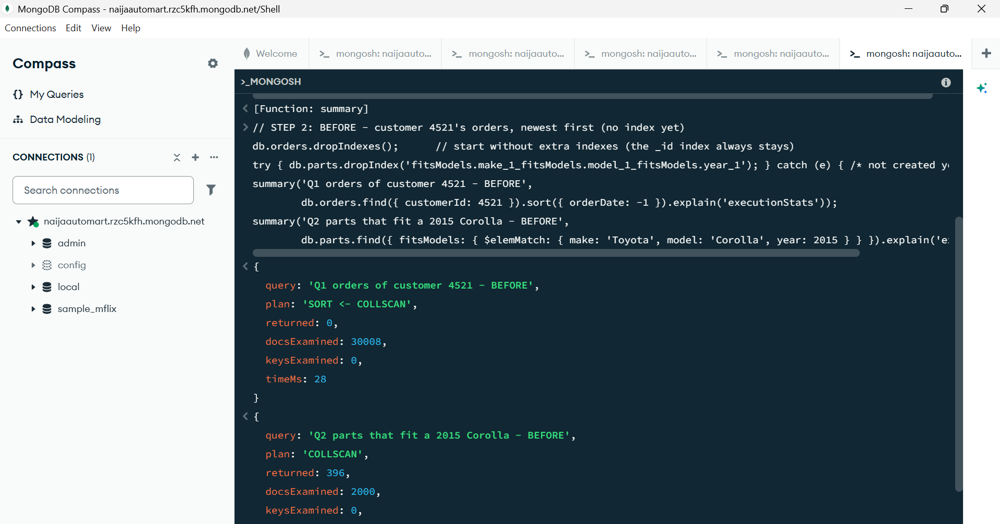
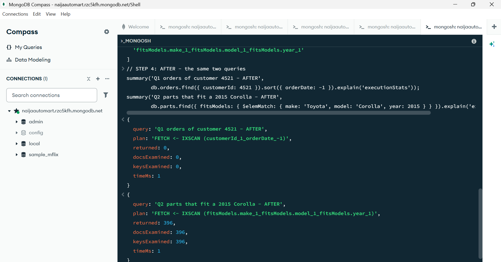
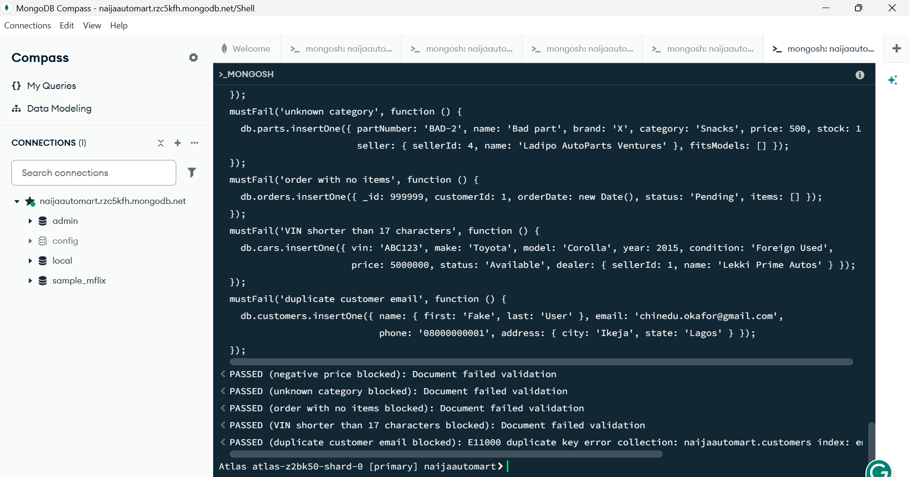
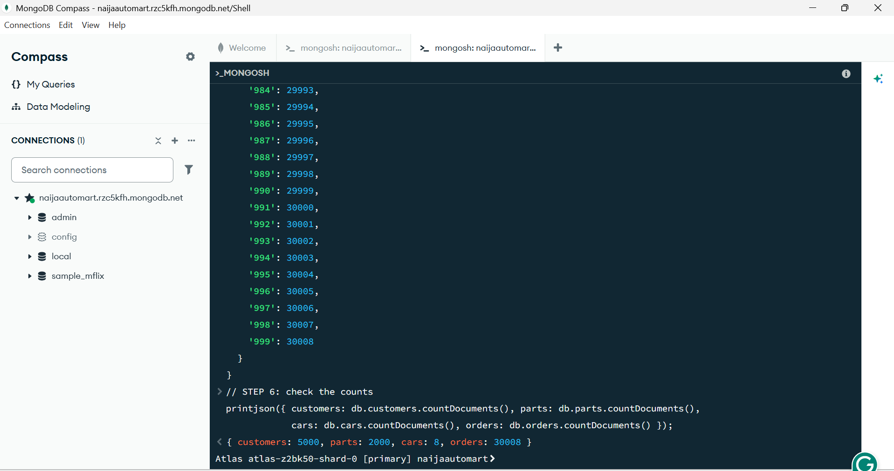

# Portfolio 4: NoSQL and Advanced Data Models

This portfolio rebuilds the NaijaAutoMart catalogue, cars, customers and orders as a **document database** in **MongoDB Atlas** (MongoDB's cloud service). It then compares when documents work better than PostgreSQL's tables, and when they don't.

*NoSQL = Not only SQL (Structured Query Language). Abbreviations are spelled out on first use. Full list: [abbreviations.md](../docs/abbreviations.md).*

| Required by the brief | Where to find it |
|---|---|
| NoSQL model based on the same case study | [The document model](#the-document-model) |
| Document example | [Example documents](#example-documents), [02_insert_data.js](scripts/02_insert_data.js) |
| Implementation evidence | [Evidence](#evidence): scripts run on MongoDB Atlas |
| Explanation of suitability | [Why MongoDB suits this data (and where it doesn't)](#why-mongodb-suits-this-data-and-where-it-doesnt) |

---

## The document model

MongoDB stores **documents** (JSON, JavaScript Object Notation, saved as BSON, Binary JSON) in **collections**. Unlike a table, documents in the same collection don't need identical fields, and a document can hold lists and smaller documents inside it.

The 14 PostgreSQL tables from Portfolio 1 become **4 collections**:

| Collection | Holds | Was in PostgreSQL |
|---|---|---|
| **parts** | Each part, with its own attributes, the car models it fits, its seller's name and its latest reviews | PART, PART_CATEGORY, PART_FITMENT, REVIEW, part of SELLER |
| **cars** | Each car for sale, with its own extra details and its inspection bookings | CAR_LISTING, CAR_MODEL, INSPECTION, part of SELLER |
| **customers** | Each customer | CUSTOMER |
| **orders** | Each order, with its items, payments and delivery inside | ORDERS, ORDER_ITEM, PAYMENT, DELIVERY, part of DELIVERY_AGENT |

### Embed or reference? The main design decision

Data used together should be **embedded**, stored inside one document. Data that is shared, grows without limit, or changes on its own should be **referenced**, stored once and linked by an ID.

| Data | Choice | Reason |
|---|---|---|
| Order items, payments, delivery | **Embedded** in the order | Always read with the order, and never shared with other orders. One read gets the whole order |
| Car models a part fits | **Embedded** in the part (`fitsModels` list) | Short list, read every time someone searches "parts for my car" |
| Part attributes (tyre size, battery Ah…) | **Embedded** (`attributes`) | Different for every kind of part; this is where documents are most useful |
| Latest reviews | **Embedded**, only the newest 5 (`$slice: -5`) | Show on the product page instantly; capping the list stops the document growing forever |
| Inspection bookings | **Embedded** in the car | Few per car, always viewed with the car |
| Customer | **Referenced** from orders (`customerId`) | One customer has thousands of orders; their details are stored once and joined with `$lookup` when needed |
| Seller name, customer name on an order | **Copied** (a small snapshot) | Saves a join on every read. Trade-off: if a seller renames, old copies keep the old name |

---

## Example documents

**A part:** a battery has battery fields; a tyre would have size fields instead.
```json
{
  "_id": 2,
  "partNumber": "VAR-75AH",
  "name": "Car Battery 75Ah",
  "brand": "Varta",
  "category": "Batteries",
  "price": 95000,
  "stock": 25,
  "seller": { "sellerId": 4, "name": "Ladipo AutoParts Ventures", "city": "Mushin" },
  "attributes": { "capacityAh": 75, "voltage": 12, "coldCrankingAmps": 680, "warrantyMonths": 24 },
  "fitsModels": [
    { "make": "Toyota", "model": "Corolla", "year": 2015 },
    { "make": "Toyota", "model": "Camry",   "year": 2018 },
    { "make": "Honda",  "model": "Accord",  "year": 2017 }
  ],
  "rating": { "count": 1, "average": 5 },
  "recentReviews": [ { "customerId": 2, "name": "Aisha B.", "rating": 5,
                       "comment": "Battery delivered the next day in Kano. Car starts first time." } ]
}
```

**An order:** everything about the order in one document. In PostgreSQL this is spread across 4 tables.
```json
{
  "_id": 3,
  "customerId": 5,
  "customerName": "Ibrahim Musa",
  "orderDate": "2026-09-10T09:05:00Z",
  "status": "Delivered",
  "items": [
    { "partId": 5, "name": "Oil Filter",             "category": "Filters",      "quantity": 2, "unitPrice": 7000 },
    { "partId": 6, "name": "Spark Plugs (set of 4)", "category": "Engine Parts", "quantity": 1, "unitPrice": 28000 }
  ],
  "payments": [ { "amount": 42000, "method": "Card",          "status": "Failed" },
                { "amount": 42000, "method": "Bank Transfer", "status": "Successful" } ],
  "delivery": { "address": "7 Aminu Kano Crescent, Wuse 2", "city": "Abuja", "state": "FCT",
                "agent": "Musa Ibrahim", "status": "Delivered" }
}
```

---

## What the scripts do

| Script | What it shows |
|---|---|
| [01_create_collections.js](scripts/01_create_collections.js) | Creates the 4 collections with **`$jsonSchema` validation** (price > 0, stock ≥ 0, allowed categories, 17-character VIN…) and unique indexes. "Schemaless" doesn't mean "no rules" |
| [02_insert_data.js](scripts/02_insert_data.js) | Loads the same data as Portfolio 1, then generates 2,000 parts, 5,000 customers and 30,008 orders |
| [03_queries_and_updates.js](scripts/03_queries_and_updates.js) | CRUD (Create, Read, Update, Delete): parts for a 2015 Corolla in **one query** (no joins); search inside flexible attributes; one complete order in one read; an **atomic** stock update that cannot oversell (the same idea as Portfolio 3's Fix 2); a new review pushed and capped at 5 |
| [04_aggregations.js](scripts/04_aggregations.js) | Reports using the **aggregation pipeline**: revenue by category for September 2026, best-rated parts, spending by state, a **`$lookup`** join from orders to customers, and the car models with the most parts |
| [05_indexes_and_validation.js](scripts/05_indexes_and_validation.js) | `explain()` **before and after** indexes (COLLSCAN → IXSCAN), including a **multikey index** on the `fitsModels` list, and 5 validation tests that must be rejected |

### Results to expect

| Step | Expected result |
|---|---|
| 02 step 6 | 5,000 customers, 2,000 parts, 8 cars, 30,008 orders |
| 03 step 1 | 6 parts fit a 2015 Corolla: the same 6 as Portfolio 1's query Q2 |
| 03 step 5 | First sale `modifiedCount: 1`, second `modifiedCount: 0`, stock ends at 0 |
| 04 step 4 | Order totals ₦51,000, ₦95,000, ₦42,000, ₦480,000, ₦159,500, ₦260,000, ₦170,000, ₦147,000: the same as PostgreSQL |
| 05 step 2 → 4 | Q1 changes from **COLLSCAN** reading all 30,008 orders to **IXSCAN** reading only customer 4521's orders (none in the Atlas run, so 0 documents read) |
| 05 step 5 | 5 × PASSED |

*How these were checked: the query logic of scripts 01–04 was tested with mingo, an in-memory MongoDB-compatible query engine, before running on Atlas. All of these results were then confirmed on Atlas: see the [Evidence](#evidence) below.*

---

## Why MongoDB suits this data (and where it doesn't)

| NaijaAutoMart data | Best store | Why |
|---|---|---|
| **Parts catalogue** | **MongoDB** | Every kind of part has different attributes. In SQL this needs many empty columns or an extra attributes table; here each part simply has its own fields |
| **Car listings** | **MongoDB** | A brand-new car has a warranty; a Nigerian-used car has previous owners and customs papers. Documents fit naturally |
| **Reviews, activity logs** | **MongoDB** | Many small writes with a loose shape; easy to spread across servers (Portfolio 5) |
| **Payments, stock levels** | **PostgreSQL** | Need strict ACID (Atomicity, Consistency, Isolation, Durability) transactions across several records, plus foreign keys. MongoDB can do multi-document transactions, but PostgreSQL is built around them |
| **Financial reports** | **PostgreSQL** | Joins across many tables and strict consistency are SQL's strength |

**Conclusion: polyglot persistence.** A real NaijaAutoMart would use **both**: PostgreSQL for orders, payments and stock (the money), and MongoDB for the catalogue, car listings and reviews (the flexible, read-heavy data). Each database does what it's best at.

**Honest weaknesses of this design**
- **Copied data can go stale.** Seller and customer names are copied into parts and orders. If a seller changes its name, every copy has to be updated, or old documents keep the old name.
- **No foreign keys.** MongoDB won't stop an order pointing to a `customerId` that doesn't exist; the application must check. PostgreSQL blocked this automatically (Portfolio 1, Test 4).
- **Embedded lists must stay small.** A document can be at most 16 MB, which is why reviews are capped at the latest 5 and customers are referenced, not embedded.

---

## How to run it (MongoDB Compass + Atlas)

1. Open **MongoDB Compass** and connect to your Atlas cluster.
2. Click the **`>_`** button (Open MongoDB shell) next to your connection. A **mongosh** shell opens at the bottom.
3. Open each script in VS Code or Notepad, copy **one STEP at a time**, paste it into the shell and press **Enter**.
4. Run the scripts in order **01 → 05**. Use the **same shell tab** for all of script 02, because step 5 reuses names from steps 2–4.

Your Atlas connection string and password are **never** stored in these scripts or on GitHub.

---

## Evidence

All five scripts were run step by step in the **mongosh** (MongoDB Shell) tab of **MongoDB Compass**, connected to my free **MongoDB Atlas** cluster (`atlas-z2bk50-shard-0 [primary]`, database `naijaautomart`) on 14 October 2026. All 34 screenshots are in [evidence/screenshots](evidence/screenshots/).

### Key results from the real Atlas run

| What was tested | Result on Atlas |
|---|---|
| Data loaded (02 step 6) | **5,000** customers, **2,000** parts, **8** cars, **30,008** orders |
| Atomic stock update (03 step 5) | First sale `modifiedCount: 1`, second `modifiedCount: 0`: no overselling |
| Create then delete (03 step 7) | `insertedId: 99999`, then `deletedCount: 1` |
| Revenue by category, Sept 2026 (04 step 1) | Batteries top at ₦132,542,500 from 343 orders; Lighting lowest at ₦63,019,000 |
| Spending by state (04 step 3) | Lagos first: ₦2,614,596,000 from 4,714 orders |
| `$lookup` join (04 step 4) | Order 1 → Chinedu Okafor, Ikeja, ₦51,000 … order 8 → Kemi Oladipo, Benin City, ₦147,000: the same totals as PostgreSQL |
| Parts per car model (04 step 5) | 2018 Toyota Camry has the most parts (404); 2015 Corolla has 396 |
| Validation (05 step 5) | **5 × PASSED**: all bad documents rejected |

### Indexes: before and after (05 steps 2 and 4)

| Query | Before (no index) | After (with index) |
|---|---|---|
| Q1 orders of customer 4521, newest first | **SORT ← COLLSCAN**: read all **30,008** orders, 28 ms | **FETCH ← IXSCAN** (`customerId_1_orderDate_-1`): read **0** orders, 1 ms |
| Q2 parts that fit a 2015 Corolla | **COLLSCAN**: read all **2,000** parts | **FETCH ← IXSCAN** (multikey index on `fitsModels`): read only the **396** matching parts |

*Note on Q1:* in this run customer 4521 happened to have no orders, so the query returned 0. That actually makes the point clearly: without the index MongoDB still had to read all 30,008 orders to find that out; with the index it looked at the index once and read **no** documents at all. The sort step also disappeared, because the index already keeps each customer's orders in date order.

**Before: full collection scan**



**After: index scan**



**Validation rules reject bad data**



**Data loaded on Atlas**



### All screenshots

**Script 01: create collections with validation rules**

| Screenshot | Shows |
|---|---|
| [01_step1_start_create_customers](evidence/screenshots/01_step1_start_create_customers.png) | Switching to the `naijaautomart` database and creating `customers` with `$jsonSchema` |
| [01_parts_collection_created](evidence/screenshots/01_parts_collection_created.png) | `parts` collection created (`ok: 1`) |
| [01_cars_collection_created](evidence/screenshots/01_cars_collection_created.png) | `cars` collection created |
| [01_orders_collection_created](evidence/screenshots/01_orders_collection_created.png) | `orders` collection created |
| [01_indexes_and_collection_list](evidence/screenshots/01_indexes_and_collection_list.png) | Unique indexes created and the 4 collection names listed |

**Script 02: insert data**

| Screenshot | Shows |
|---|---|
| [02_customers_insert_a](evidence/screenshots/02_customers_insert_a.png), [b](evidence/screenshots/02_customers_insert_b.png) | Portfolio 1 customers inserted |
| [02_parts_insert_a](evidence/screenshots/02_parts_insert_a.png), [b](evidence/screenshots/02_parts_insert_b.png) | 15 parts inserted, each with its own attributes and `fitsModels` list |
| [02_cars_insert_a](evidence/screenshots/02_cars_insert_a.png), [b](evidence/screenshots/02_cars_insert_b.png) | 8 cars inserted |
| [02_orders_insert_a](evidence/screenshots/02_orders_insert_a.png), [b](evidence/screenshots/02_orders_insert_b.png) | 8 orders inserted, with items, payments and delivery embedded |
| [02_step5_generate_data_code](evidence/screenshots/02_step5_generate_data_code.png) | Code that generates the larger test data |
| [02_step5_batch_inserts](evidence/screenshots/02_step5_batch_inserts.png) | Generated data inserted in batches |
| [02_step6_counts_5000_2000_8_30008](evidence/screenshots/02_step6_counts_5000_2000_8_30008.png) | Final counts: 5,000 / 2,000 / 8 / 30,008 |

**Script 03: CRUD (Create, Read, Update, Delete)**

| Screenshot | Shows |
|---|---|
| [03_q1_parts_for_2015_corolla](evidence/screenshots/03_q1_parts_for_2015_corolla.png) | Parts that fit a 2015 Corolla in one query, no joins |
| [03_q2_16inch_tyre_attributes](evidence/screenshots/03_q2_16inch_tyre_attributes.png) | Searching inside the flexible `attributes` (16-inch tyre) |
| [03_q3_cars_under_20m](evidence/screenshots/03_q3_cars_under_20m.png) | Cars under ₦20 million |
| [03_q4_full_order_one_read](evidence/screenshots/03_q4_full_order_one_read.png) | Order 3 with its items, payments and delivery in one read |
| [03_q5_atomic_update_1_then_0](evidence/screenshots/03_q5_atomic_update_1_then_0.png) | Atomic stock update: `modifiedCount` 1, then 0 |
| [03_q6_review_push_capped](evidence/screenshots/03_q6_review_push_capped.png) | New review added and the list capped at 5 |
| [03_q7_create_then_delete](evidence/screenshots/03_q7_create_then_delete.png) | A test customer inserted, then deleted |

**Script 04: aggregation pipeline reports**

| Screenshot | Shows |
|---|---|
| [04_step1_revenue_by_category](evidence/screenshots/04_step1_revenue_by_category.png) | Revenue by part category for September 2026 |
| [04_step2_best_rated_parts](evidence/screenshots/04_step2_best_rated_parts.png) | Best-rated parts |
| [04_step3_spending_by_state](evidence/screenshots/04_step3_spending_by_state.png) | Orders and money spent per state (top 5) |
| [04_step4_lookup_orders_customers](evidence/screenshots/04_step4_lookup_orders_customers.png) | `$lookup` joining orders to customers |
| [04_step5_models_with_most_parts](evidence/screenshots/04_step5_models_with_most_parts.png) | Car models with the most parts (`$unwind` on `fitsModels`) |

**Script 05: indexes and validation**

| Screenshot | Shows |
|---|---|
| [05_step1_explain_helper](evidence/screenshots/05_step1_explain_helper.png) | Small helper that prints the key `explain()` numbers |
| [05_step2_before_collscan](evidence/screenshots/05_step2_before_collscan.png) | Before indexes: COLLSCAN |
| [05_step3_create_indexes](evidence/screenshots/05_step3_create_indexes.png) | Compound index on orders and multikey index on parts |
| [05_step4_after_ixscan](evidence/screenshots/05_step4_after_ixscan.png) | After indexes: IXSCAN |
| [05_step5_validation_tests_code](evidence/screenshots/05_step5_validation_tests_code.png) | The 5 invalid inserts |
| [05_step5_validation_5_passed](evidence/screenshots/05_step5_validation_5_passed.png) | All 5 rejected: PASSED |
