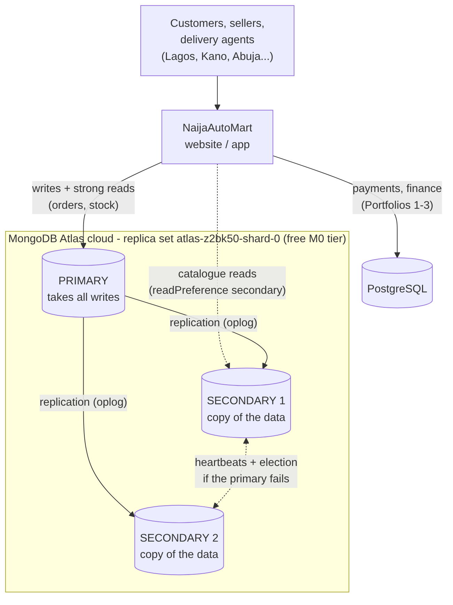
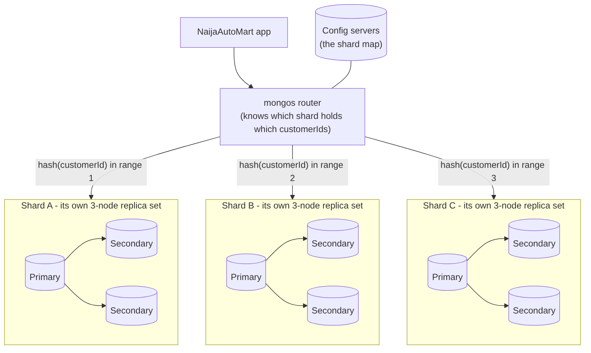
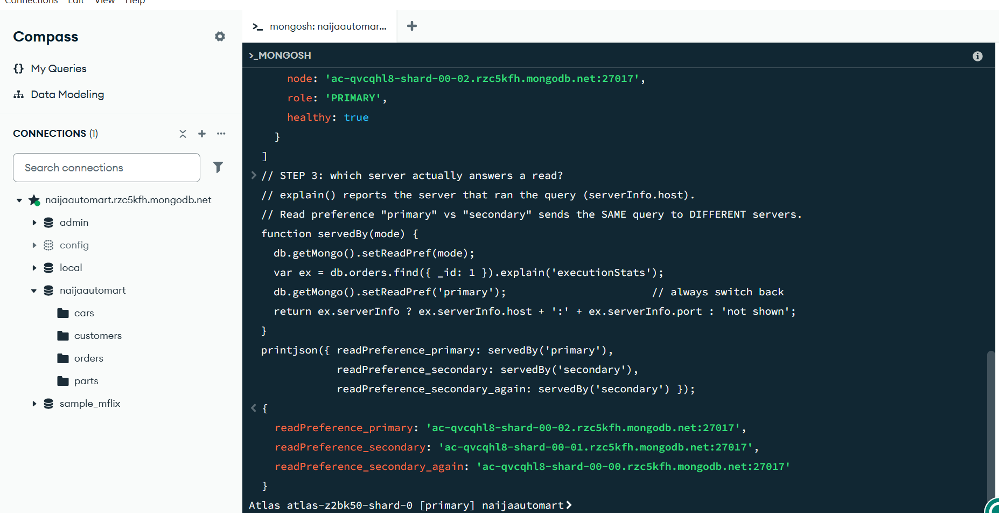
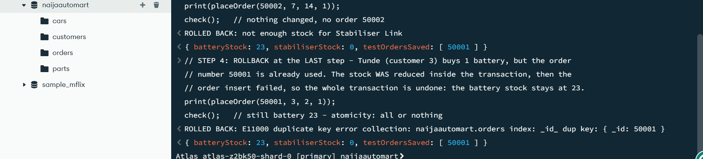
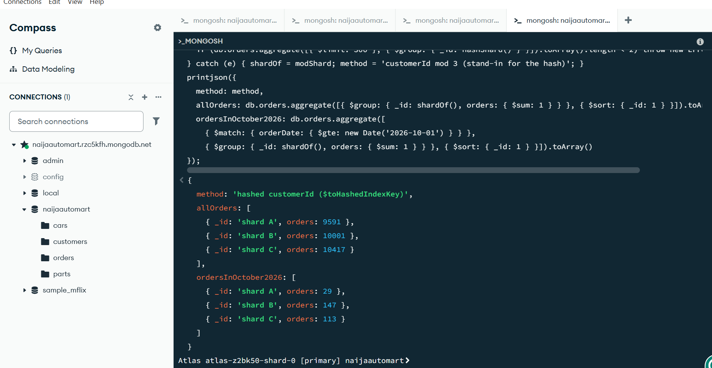

# Portfolio 5: Distributed and Cloud Database Exercise

This portfolio takes the NaijaAutoMart MongoDB database from Portfolio 4, now running in the cloud on **MongoDB Atlas**, and shows how it works as a **distributed** database. It covers replication, consistency, transactions, a sharding design and backup/restore. Every test runs on the real Atlas cluster.

*Abbreviations are spelled out on first use. Full list: [abbreviations.md](../docs/abbreviations.md).*

| Required by the brief | Where to find it |
|---|---|
| Distributed/cloud setup based on the same case study | [The cloud deployment](#1-the-cloud-deployment), [01_replica_set.js](scripts/01_replica_set.js) |
| Replication | [Replication](#2-replication), [01_replica_set.js](scripts/01_replica_set.js) |
| Consistency | [Consistency](#3-consistency-how-up-to-date-is-each-read), [02_consistency.js](scripts/02_consistency.js), [03_distributed_transaction.js](scripts/03_distributed_transaction.js) |
| Sharding | [Sharding design](#4-sharding-design), [04_sharding_design.js](scripts/04_sharding_design.js) |
| Availability | [Availability](#5-availability-failover-and-backups), [05_backup_restore.js](scripts/05_backup_restore.js) |
| Deployment evidence | [Evidence](#evidence): Atlas screenshots and script output |

---

## 1. The cloud deployment

| Item | My setup |
|---|---|
| Service | MongoDB Atlas, a DBaaS (Database as a Service): MongoDB runs the servers, I only connect |
| Tier | **M0** (free), MongoDB **8.0.34** |
| Region | **AWS Cape Town (af-south-1)**: the nearest Atlas region to Nigeria |
| Shape | **Replica set** `atlas-z2bk50-shard-0`: **3 nodes** `ac-qvcqhl8-shard-00-00`, `-01` and `-02` (1 primary, 2 secondaries) |
| Database | `naijaautomart` (the 4 collections from Portfolio 4: 5,000 customers, 2,000 parts, 8 cars, 30,008 orders) |
| Client | MongoDB Compass and its built-in mongosh (MongoDB Shell), on my Windows PC |
| Security | Database user with a password; only my IP (Internet Protocol) address is allowed in (Network Access). The connection string and password are **never** stored in the scripts or on GitHub |

*How the app would use it: writes and important reads go to the primary; catalogue browsing can be served by a secondary; payments stay in PostgreSQL (the polyglot design from Portfolio 4).*

---

## 2. Replication

**What it is:** the same data is kept on 3 servers. The **primary** takes every write and records it in its **oplog** (operation log). The two **secondaries** read the oplog and repeat each change, so they hold copies of the data.

**Why NaijaAutoMart needs it:**
- **No single point of failure.** If one server dies, two copies remain and the shop stays open.
- **Read scaling.** Customers browsing parts can be served by secondaries, taking load off the primary.

**What script 01 shows:**

| Step | Shows |
|---|---|
| 1 | `hello()` lists the replica set name, the **3 member servers** and which one is the primary |
| 2 | `rs.status()` shows each node's role and health: 2 × SECONDARY and 1 × PRIMARY, all healthy |
| 3 | The same query sent with read preference `primary` and then `secondary` is answered by **different servers** (`explain().serverInfo.host`) |
| 4 | A delivery event written to the primary is read back from a **secondary**: the data really was copied |

---

## 3. Consistency: how up to date is each read?

With 3 copies, a secondary can be a few milliseconds behind the primary. MongoDB lets the application choose, **per operation**, between speed and safety:

| Setting | Options | In simple words |
|---|---|---|
| **Write concern** | `w: 1` | "Saved" once the primary has it. Fast, but if the primary crashes before copying it, the write can be lost |
| | `w: 'majority'` | "Saved" once **2 of 3** servers have it. Slower, but survives a failover |
| **Read concern** | `local` / `majority` | Read the newest data on that server, or only data a majority already has (can never be rolled back) |
| **Read preference** | `primary` / `secondary` | Which server answers |

**What script 02 tested, and what happened on Atlas:**

| Test | Result | What it means |
|---|---|---|
| **Speed:** 100 inserts with `w: 1` vs 100 with `w: 'majority'` | `w: 1`: **152.2 ms** per insert. `w: 'majority'`: **135.2 ms** per insert | No measurable cost for `'majority'`. Each insert travels from my PC in Nigeria to Cape Town and back, which takes about 135–150 ms. The extra wait for a second copy happens inside the Cape Town data centre and takes only a few ms, which is smaller than the normal network variation. The first run also included warming up the connection. **Lesson:** for NaijaAutoMart, the safe setting costs almost nothing |
| **`w: 5`** on a 3-node set | **Refused**: `UnsatisfiableWriteConcern - Not enough data-bearing nodes` | Write concern really counts servers. **But step 6 found the document anyway:** the primary had already saved it. A write concern error says "I could not *confirm* the copies you asked for". It does not undo the write, so the application must handle it |
| **Stale reads:** write with `w: 1`, then immediately read from a secondary, 100 times | **0 of 100** missed | The secondaries copied each write in less time than one round trip from Lagos to Cape Town. This does **not** mean reads are always fresh: an app server inside the same data centre reads within 1–2 ms and could see a miss. Nothing *guarantees* it |
| **Read your own writes:** the same test in a **causally consistent session** (`w: 'majority'` + read concern `majority`) | **0 of 100** missed (23.7 seconds for 100 write+read pairs) | Here 0 is **guaranteed**: the secondary waits until it has the write before answering. This is the setting for the "My orders" page |

**Script 03: a transaction across the replica set.** Placing an order changes two collections (stock in `parts`, a new document in `orders`). A multi-document **ACID** (Atomicity, Consistency, Isolation, Durability) transaction with `writeConcern: 'majority'` makes it all-or-nothing:

| Step | Test | Result on Atlas |
|---|---|---|
| 2 | Aisha buys 2 batteries | ✅ **COMMITTED**: stock 25 → 23, order 50001 saved |
| 3 | Emeka buys a sold-out stabiliser link | ✅ **ROLLED BACK**: `not enough stock for Stabiliser Link`, nothing changed |
| 4 | Tunde buys a battery, but the order number is already used | ✅ **ROLLED BACK**: `E11000 duplicate key error ... _id: 50001`. The stock was reduced inside the transaction, then undone: stock stays at **23** |

### CAP theorem: what NaijaAutoMart chooses

The **CAP** theorem says that when the network between servers breaks (a **P**artition), a distributed database must choose between **C**onsistency (every read sees the latest write) and **A**vailability (every request gets an answer). A MongoDB replica set chooses **consistency** for writes: only the side of the partition with a majority of nodes can have a primary, and the minority side refuses writes rather than accept ones that could clash.

Different NaijaAutoMart data needs different trade-offs:

| Operation | Needs | Settings | Why |
|---|---|---|---|
| Payment, stock update, placing an order | **Strong consistency** | Primary, `w: 'majority'`, transaction | Selling stock twice or losing a paid order costs real money |
| "My orders" page after checkout | **Read your own writes** | Causal session, read concern `majority` | The customer must see the order they just placed |
| Browsing the parts catalogue, car listings | **Eventual consistency is fine** | Read preference `secondary` | A price that is 50 ms old does no harm; spreading reads keeps the site fast |
| Delivery tracking events, reviews | **Eventual consistency, fast writes** | `w: 1` | High volume; losing one GPS (Global Positioning System) update in a rare crash is acceptable |

**Synchronous vs asynchronous replication.** MongoDB copies data **asynchronously**: the primary does not wait for the secondaries unless the write concern asks it to. `w: 'majority'` makes a write wait for a second copy, which gives most of the safety of synchronous replication without waiting for every node.

---

## 4. Sharding design

**Replication copies** the data; **sharding splits** it. Each **shard** is its own replica set holding part of the data, and a **mongos router** sends each query to the right shard. NaijaAutoMart would need this once orders outgrow one server, or to keep Lagos traffic from slowing everyone else.

The free tier cannot be sharded (Atlas needs a paid M30 or larger cluster), so script 04 **simulates 3 shards** on the real 30,008 orders to choose the **shard key** for `orders`:

| Candidate key | What the simulation shows | Verdict |
|---|---|---|
| `delivery.state` | Only **11 different values**. **Lagos alone is 17.7%** of orders (5,312), against 6.4% for Edo. All orders with the same key value must stay together, so Lagos can never be split across shards. Growth in Lagos would overload one shard | ❌ Low cardinality (few possible values), hotspot |
| `orderDate` (ranges) | Old orders spread well (9,354 / 10,636 / 10,019), but **all 289 orders from October 2026 land on shard C**, the one holding the newest dates | ❌ Write hotspot: one shard takes 100% of new orders |
| **`customerId` (hashed)** | All orders: **9,591 / 10,001 / 10,417**, an even spread. October's 289 new orders: **29 / 147 / 113**, shared by all 3 shards | ✅ **Chosen** |

*Why October's hashed split is lumpy (29 / 147 / 113):* it is a small sample, and my test-data generator from Portfolio 4 uses a simple random-number formula whose consecutive numbers are slightly linked, so the customer IDs picked for late dates are not perfectly random. With real customers it would even out. Even so, every shard takes part of the new writes, unlike the date key, where one shard took all 289.

**Trade-off of the chosen key:**
- **Targeted queries are fast.** "My orders" for one customer goes to **one** shard (measured: 1 shard asked), which is the most common query in the app.
- **Reports are scatter-gather.** "Revenue for September" must ask **all** shards (measured: 3 shards asked) and merge the answers. That is acceptable for a nightly report, and Portfolio 4's analysis could run on a secondary or an analytics node.
- **Rebalancing:** when a 4th shard is added, the balancer moves chunks (ranges of hash values) to it automatically, with no downtime.

**Possible next step:** add **zone sharding** with a key such as `{ region: 1, customerId: 'hashed' }` to keep each region's orders on servers in or near Nigeria.

---

## 5. Availability: failover and backups

**Automatic failover.** If the primary stops answering heartbeats for about 10 seconds, the secondaries hold an **election** and one becomes the new primary. MongoDB drivers use **retryable writes**, so an order sent during the switch is retried once on the new primary instead of failing. With 3 nodes the cluster survives **1** server failing (2 of 3 is still a majority).

**Replication is not a backup.** If an admin deletes the parts catalogue by mistake, the delete is copied to all 3 servers within milliseconds. Script 05 tests a real **backup and restore**: export `parts` from Compass, delete every part, import the file, then check that the count, total stock and a sample part all match.

| Target | Meaning | NaijaAutoMart goal | How |
|---|---|---|---|
| **RPO** (Recovery Point Objective) | How much data we can afford to lose | Orders and payments: **0**. Catalogue: **24 hours** | `w: 'majority'` for orders; daily backups for the catalogue |
| **RTO** (Recovery Time Objective) | How long we can be down | Checkout: **under 1 minute**. Restore of a lost collection: **under 1 hour** | Automatic failover (seconds); restore time measured in script 05 |

### Limits of the free tier, honestly

| Limit on M0 | Effect on this portfolio | What a production NaijaAutoMart would use |
|---|---|---|
| No "Test Primary Failover" button (Atlas allows it on M10 and above) | Failover is explained, not triggered | M10+ cluster, and test failover before launch |
| Cannot be sharded | Sharding is simulated on real data (script 04) | M30+ sharded cluster with hashed `customerId` |
| Fixed at 3 nodes in one region | Survives a server failure, not a whole-region outage | Nodes in 2–3 regions |

---

## How to run it

1. Run Portfolio 4's scripts first, so the `naijaautomart` data exists on Atlas.
2. In Compass, open the **`>_`** mongosh shell on your Atlas connection.
3. Paste **one STEP at a time** from scripts **01 → 05**, in order. Script 05 has two mouse steps in Compass, explained in the script.
4. Scripts can be re-run: each one resets its own test data first.

| Script | What it shows |
|---|---|
| [01_replica_set.js](scripts/01_replica_set.js) | The 3-node replica set; reads served by primary vs secondary; a write copied to a secondary |
| [02_consistency.js](scripts/02_consistency.js) | Write concern speed, `w: 5` refused, stale reads vs a causally consistent session |
| [03_distributed_transaction.js](scripts/03_distributed_transaction.js) | Place-order transaction: 1 commit and 2 rollbacks |
| [04_sharding_design.js](scripts/04_sharding_design.js) | Three shard keys compared on real data; targeted vs scatter-gather queries |
| [05_backup_restore.js](scripts/05_backup_restore.js) | Backup, accidental delete, restore, check |

*How these were checked: the script logic was tested in an in-memory MongoDB-compatible engine (mingo) with a stand-in replica set before running on Atlas. The real Atlas run on 19 October 2026 is the evidence below.*

---

## Evidence

All scripts were run in the mongosh shell of **MongoDB Compass**, connected to the Atlas cluster, on 19 October 2026. The Atlas screenshots were taken on the Atlas website. IP addresses are blurred, and the password never appears. All 33 screenshots are in [evidence/screenshots](evidence/screenshots/).

### Key results

| What was tested | Result on Atlas |
|---|---|
| Deployment | Atlas **M0**, MongoDB **8.0.34**, **AWS Cape Town (af-south-1)**, 158 MB of 512 MB used |
| Replica set (01 step 1–2) | 3 members; `ac-qvcqhl8-shard-00-02` is **PRIMARY**, `-00` and `-01` are **SECONDARY**, all healthy |
| Read preference (01 step 3) | `primary` → node **-02**; `secondary` → node **-01**, then node **-00**: the same query answered by different servers |
| Replication (01 step 4) | Written with `w: 'majority'`, read back from a secondary |
| `w: 5` (02 step 3) | Refused: `UnsatisfiableWriteConcern`, but the document was still saved |
| Stale reads (02 steps 4–5) | 0/100 without a guarantee; 0/100 **guaranteed** with a causal session |
| Transaction (03) | 1 commit, 2 rollbacks; battery stock ends at 23 in every case it should |
| Sharding simulation (04) | State: Lagos 17.7%. Date: 100% of new orders on one shard. Hashed `customerId`: 9,591 / 10,001 / 10,417 |
| Backup (05) | Before: 2,000 parts, 192,659 stock units. Exported to JSON, then all 2,000 deleted. *Restore check: see the note below* |

**The cluster on Atlas: 3 nodes, 1 primary and 2 secondaries, in Cape Town**

**Same query, different servers (read preference)**

**Transaction: an order rolled back at the last step, stock unchanged**

**Hashed shard key spreads orders evenly**

### All screenshots

**Atlas (cloud deployment)**

| Screenshot | Shows |
|---|---|
| [atlas_1_project_overview_cluster](evidence/screenshots/atlas_1_project_overview_cluster.png) | Project with the NaijaAutoMart cluster, 158.35 MB / 512 MB used (IP blurred) |
| [atlas_2_cluster_overview_free_tier_cape_town_3_nodes](evidence/screenshots/atlas_2_cluster_overview_free_tier_cape_town_3_nodes.png) | Version 8.0.34, AWS Cape Town, Free tier, 2 SECONDARY + 1 PRIMARY |
| [atlas_3_metrics_three_nodes_primary_secondary](evidence/screenshots/atlas_3_metrics_three_nodes_primary_secondary.png) | Metrics for each of the 3 nodes (S, S, P) |
| [atlas_4_metrics_network_all_three_nodes](evidence/screenshots/atlas_4_metrics_network_all_three_nodes.png) | Network traffic on all 3 nodes at the same time: replication at work |
| [atlas_5_metrics_connections_all_three_nodes](evidence/screenshots/atlas_5_metrics_connections_all_three_nodes.png) | Connections to all 3 nodes |
| [atlas_6_connect_string_password_hidden](evidence/screenshots/atlas_6_connect_string_password_hidden.png) | Connection string: `mongodb+srv://` finds the replica set members; the password stays a placeholder |
| [atlas_7_network_access_ip_list_blurred](evidence/screenshots/atlas_7_network_access_ip_list_blurred.png) | Network Access: only listed IP addresses can connect (blurred) |
| [atlas_8_project_users_roles](evidence/screenshots/atlas_8_project_users_roles.png) | Project user and role (Project Owner) |

**Script 01: replica set**

| Screenshot | Shows |
|---|---|
| [01_step1_hello_replica_set_members](evidence/screenshots/01_step1_hello_replica_set_members.png) | Replica set name, 3 members, current primary, version 8.0.34 |
| [01_step2_rs_status_a](evidence/screenshots/01_step2_rs_status_a.png), [b](evidence/screenshots/01_step2_rs_status_b_step3_read_preference.png) | Each node's role and health; read preference sends the query to different servers |
| [01_step4_write_primary_read_secondary](evidence/screenshots/01_step4_write_primary_read_secondary.png) | Delivery event written, then read from a secondary |

**Script 02: consistency**

| Screenshot | Shows |
|---|---|
| [02_step1_delivery_events_ready](evidence/screenshots/02_step1_delivery_events_ready.png) | Test collection created |
| [02_step2_write_concern_timing_a](evidence/screenshots/02_step2_write_concern_timing_a.png), [b](evidence/screenshots/02_step2_timing_b_step3_w5_refused.png) | `w: 1` vs `w: 'majority'` timings; `w: 5` refused |
| [02_step4_stale_read_test](evidence/screenshots/02_step4_stale_read_test.png) | 0 of 100 reads missed on a secondary |
| [02_step5_causal_session](evidence/screenshots/02_step5_causal_session.png) | Causally consistent session: 0 of 100, guaranteed |
| [02_step6_delivery_events_counts](evidence/screenshots/02_step6_delivery_events_counts.png) | All test documents, including the `w: 5` one |

**Script 03: transaction**

| Screenshot | Shows |
|---|---|
| [03_step1_place_order_function_a](evidence/screenshots/03_step1_place_order_function_a.png), [b](evidence/screenshots/03_step1_place_order_function_b.png) | `placeOrder()` and the starting stock (25 / 0) |
| [03_step2_commit](evidence/screenshots/03_step2_commit.png) | COMMITTED: stock 23, order 50001 |
| [03_step3_rollback_no_stock](evidence/screenshots/03_step3_rollback_no_stock.png) | ROLLED BACK: no stock |
| [03_step4_rollback_duplicate_order](evidence/screenshots/03_step4_rollback_duplicate_order.png) | ROLLED BACK at the last step; stock still 23 |

**Script 04: sharding design**

| Screenshot | Shows |
|---|---|
| [04_step1_shard_by_state](evidence/screenshots/04_step1_shard_by_state.png) | Orders per state: Lagos 17.7% |
| [04_step2_shard_by_date](evidence/screenshots/04_step2_shard_by_date.png) | Date ranges: all October orders on shard C |
| [04_step3_hashed_code](evidence/screenshots/04_step3_hashed_code.png), [results](evidence/screenshots/04_step3_hashed_results.png) | Hashed `customerId` with `$toHashedIndexKey`: even spread |
| [04_step4_targeted_vs_scatter_gather](evidence/screenshots/04_step4_targeted_vs_scatter_gather.png) | 1 shard for "my orders", 3 shards for the September report |

**Script 05: backup and restore**

| Screenshot | Shows |
|---|---|
| [05_step1_before_backup](evidence/screenshots/05_step1_before_backup.png) | Before: 2,000 parts, 192,659 stock units, battery stock 23 |
| [05_step2_compass_export](evidence/screenshots/05_step2_compass_export.png) | Backup: Compass export to JSON |
| [05_step3_delete_all_parts](evidence/screenshots/05_step3_delete_all_parts.png) | "Disaster": all 2,000 parts deleted |
| [05_step4_choose_backup_file](evidence/screenshots/05_step4_choose_backup_file.png), [import dialog](evidence/screenshots/05_step4_import_dialog.png) | Restore: importing `naijaautomart.parts.json` |

*Restore check (step 5): to be added. In the first run, step 5 was pasted before the import had finished, so it still showed 0 parts.*
